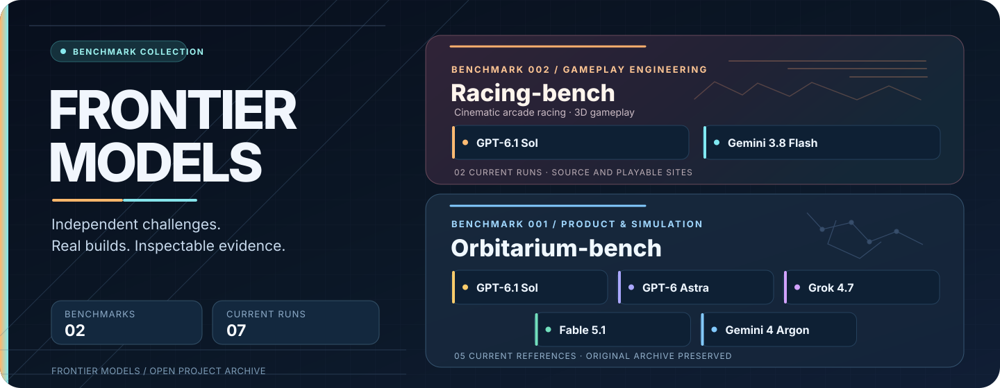

<div align="center">



<br/>

[](./benchmarks)
[](./docs/REPOSITORY-ARCHITECTURE.md)
[](./benchmarks/racing/RUNS.json)

# Frontier Models

**Prompts exatos. Proveniência fixada. Snapshots completos dos projetos. Evidências explícitas.**

[](./README.md)

[Abrir Racing-bench](./benchmarks/racing/) · [Abrir Orbitarium-bench](./benchmarks/solar-system/) · [Metodologia](./docs/METHODOLOGY.md)

</div>

## ⚔️ Execuções atuais por benchmark

### Racing-bench V3.1 — especificação atual

O **[Racing-bench V3.1 — prompt oficial congelado](./benchmarks/racing/prompts/racing-v3.1.md)** é a versão vigente: um jogo de corrida AAA-inspired no navegador com três pistas, quatro carros, cinco rivais locais, três Signature Features independentes e dezesseis sistemas avançados obrigatórios. **Ainda não existem jogos ou sites V3.1 publicados pelos modelos.**

**Legado arquivado — Racing-bench V2.6 (código preservado, links antigos para jogar removidos):**

| Modelo legado | Código arquivado |
| --- | --- |
| **GPT-6.1 Sol** | [Código](./benchmarks/racing/runs/gpt-6.1-sol/source/) |
| **Gemini 3.8 Flash** | [Código](./benchmarks/racing/runs/gemini-3.8-flash/source/) |
| **GPT-6 Astra** | [Código](./benchmarks/racing/runs/gpt-6-astra/source/) |

As três execuções da V2.6 agora são **legado/arquivadas**, não participantes da V3.1. Seus snapshots, manifestos e bundles Git continuam intactos; isso não afirma aprovação do gameplay.

### Orbitarium-bench — referências atuais

| Modelo | Projeto ao vivo | Código-fonte |
| --- | --- | --- |
| ☀️ **GPT-6.1 Sol** | [Abrir GPT-6.1 Sol](https://orbitarium-gpt-6.1-sol.biel.dev.br) | [Código: GPT-6.1 Sol](./benchmarks/solar-system/runs/gpt-6.1-sol/source/) |
| ✦ **GPT-6 Astra** | [Abrir GPT-6 Astra](https://orbitarium-gpt-6-astra.biel.dev.br) | [Código: GPT-6 Astra](./benchmarks/solar-system/runs/gpt-6-astra-max/frontier-v2/) |
| 𝕏 **Grok 4.7** | [Abrir Grok 4.7](https://orbitarium-grok-4.7.biel.dev.br) | [Código: Grok 4.7](./benchmarks/solar-system/runs/grok-4.7/source/) |
| ◆ **Fable 5.1** | [Abrir Fable 5.1](https://fable-solar-system.vercel.app) | [Código: Fable 5.1](./benchmarks/solar-system/runs/fable/frontier-v2/) |
| ◈ **Gemini 4 Argon** | [Abrir Gemini 4 Argon](https://orbitarium-gemini-4-argon.biel.dev.br) | [Código: Gemini 4 Argon](./benchmarks/solar-system/runs/gemini-4-argon/source/) |

O Orbitarium reúne **cinco referências atuais**. O Gemini 4 Argon e o GPT-6.1 Sol foram arquivados integralmente a partir de commits exatos, mas seus prompts de geração não foram comprovados; por isso não há comprovação de equivalência ao Frontier V2. O Gemini 3.8 Flash permanece no histórico **do Orbitarium** e sua execução Racing V2.6 também é **legado arquivado**.

## Como se organiza

```text
          ┌──────────────────────┐   ┌──────────────────────┐
          │ Prompts do benchmark │   │ Projetos dos modelos │
          │ entradas originais   │   │ fontes / snapshots   │
          └──────────┬───────────┘   └──────────┬───────────┘
                     │                          │
                     └────────────┬─────────────┘
                                  │
                       ┌──────────▼───────────┐
                       │   Frontier Models    │
                       │ RUNS.json · 2        │
                       │ atuais · históricos  │
                       └──────┬────────┬──────┘
                              │        │
                arquivos      │        │ dados de origem
                              │        │
                    ┌─────────▼───┐ ┌──▼──────────────────┐
                    │  Snapshots  │ │ Proveniência        │
                    │ runs/       │ │ commits · hashes ZIP│
                    │ originais   │ │ status dos prompts  │
                    └─────────────┘ └──┬──────────────────┘
                                      │ links e verificações
                         ┌────────────▼────────────┐
                         │ Links dos projetos      │
                         │ Checagens SHA-256       │
                         └─────────────────────────┘
```

O registro conecta prompts arquivados, projetos independentes, evidências de origem e referências públicas. Uma fonte fixada não significa necessariamente que exista um snapshot local, e prompts sem origem verificada permanecem distintos. Veja a [arquitetura do repositório](./docs/REPOSITORY-ARCHITECTURE.md).

## 🗂️ Modelos non-frontier ou desatualizados

Estas execuções **do Orbitarium** continuam visíveis como referência, mas ficam separadas da arena atual desse benchmark. A V3.1 do Racing-bench ainda não possui execuções publicadas; os três projetos da V2.6 são legado arquivado.

| Modelo | Classificação | Projeto / fonte | Proveniência |
| --- | --- | --- | --- |
| ☀️ **GPT-5.6 Sol V1** | Baseline histórico | Site removido | [Código V1](./benchmarks/solar-system/runs/gpt-5.6-sun-max/original/) · commit `67eb9fc51f…` |
| ☀️ **GPT-5.6 Sol V2** | Frontier desatualizado | [Abrir Sol V2](https://orbitarium-gpt-5.6-sol-v2.biel.dev.br) | [Código V2](./benchmarks/solar-system/runs/gpt-5.6-sun-max/rebuild/) · commit `93d43ae62f…` |
| 🌙 **GPT-5.6 Luna** | Non-frontier | [Abrir Luna](https://orbitarium-gpt-5.6-luna.biel.dev.br) | commit [`5fdc036884…`](https://github.com/bielxdh3/orbitario-luna/commit/5fdc036884bbeb712eb015c76db1b1eaf83c9e42) |
| 𝕏 **Grok 4.6** | Execução frontier arquivada | [Abrir Grok 4.6](https://grok-4-6-solar-system.vercel.app) | [`runs/grok-4.6/frontier-v2`](./benchmarks/solar-system/runs/grok-4.6/frontier-v2/) |
| ◈ **Gemini 3.8 Flash** | Frontier V2 arquivado | [Abrir Gemini 3.8 Flash](https://orbitarium-gemini-3.8-flash.biel.dev.br) | [`fonte fixada`](./benchmarks/solar-system/GEMINI-3.8-FLASH-PROVENANCE.md) · `805cfe87a…` |

O Luna está, por enquanto, apenas com a fonte fixada; a proveniência do prompt ainda não foi arquivada neste repositório.

## O que é Frontier Models?

**Frontier Models** é um arquivo de benchmarks para comparar sistemas de IA frontier em projetos completos e inspecionáveis, com prompts, código e proveniência verificáveis.

```text
PROMPT → EXECUÇÃO DO MODELO → SNAPSHOT / FONTE FIXADA → EVIDÊNCIAS → PROVENIÊNCIA → PROJETOS INSPECIONÁVEIS
```

## Benchmark 002 — Racing-bench

**O [Racing-bench V3.1](./benchmarks/racing/prompts/racing-v3.1.md) é o contrato oficial atual, congelado e autônomo.** Exige um jogo de corrida fotorrealista e complexo no navegador, com gráficos avançados de GPU, física profunda, três pistas/modos, quatro carros, cinco rivais locais, três Signature Features originais e dezesseis sistemas adicionais integrados. Ainda não há execuções V3.1 publicadas.

**A V2.6 agora é legado arquivado.** Seu [prompt original intacto](./benchmarks/racing/prompts/racing-v2.6.md), o [adendo histórico de execução](./benchmarks/racing/EXECUTION-ADDENDUM.md) e os códigos do [GPT-6.1 Sol](./benchmarks/racing/runs/gpt-6.1-sol/source/), [Gemini 3.8 Flash](./benchmarks/racing/runs/gemini-3.8-flash/source/) e [GPT-6 Astra](./benchmarks/racing/runs/gpt-6-astra/source/) permanecem preservados. Os links antigos de visita foram removidos da apresentação pública; isso não exclui sites externos.

## Benchmark 001 — Orbitarium-bench

O Orbitarium-bench pede a cada modelo que construa um produto completo e interativo do Sistema Solar a partir de uma especificação extensa. Ele testa design de produto, simulação e lógica orbital, câmera/navegação, estado temporal, acessibilidade, desempenho, robustez, honestidade científica, ferramentas educacionais e QA.

O caminho histórico `benchmarks/solar-system/` permanece inalterado para preservar links e a proveniência dos arquivos originais.

## Proveniência das execuções por benchmark

### Racing-bench

| Modelo | Revisão da fonte | Classificação | Status da fonte |
| --- | --- | --- | --- |
| **GPT-6.1 Sol** | Git `6f55263669…` | Legado | Arquivado |
| **Gemini 3.8 Flash** | Git `a18fcaee71…` | Legado | Arquivado |
| **GPT-6 Astra** | Git `0c615e8dc3…` | Legado | Arquivado |

Os três snapshots do Racing incluem [manifestos SHA-256 e backups Git restauráveis](./benchmarks/racing/).

### Orbitarium-bench

| Modelo | Revisão da fonte | Classificação | Status da fonte |
| --- | --- | --- | --- |
| **GPT-6.1 Sol** | Git `7caaccc7f4…` | Atual | Arquivado |
| **GPT-6 Astra** | Git `fca2ef51b4…` | Atual | Arquivado |
| **Grok 4.7** | Git `bcb1e82012…` | Atual | Arquivado |
| **Fable 5.1** | Git `7e079669e4…` | Atual | Arquivado |
| **Gemini 4 Argon** | Git `318aa80bb5…` | Atual | Arquivado |
| **GPT-5.6 Sol V1** | Git `67eb9fc51f…` | Histórico | Arquivado |
| **GPT-5.6 Sol V2** | Git `93d43ae62f…` | Histórico | Arquivado |
| **Grok 4.6** | ZIP SHA-256 `5d77eeb509…` | Histórico | Arquivado |
| **Gemini 3.8 Flash** | Git `805cfe87a6…` | Histórico | Apenas fonte fixada |
| **GPT-5.6 Luna** | Git `5fdc036884…` | Non-frontier | Apenas fonte fixada |

**Classificação** indica a posição da execução *dentro do próprio benchmark*: Atual, Histórico (incluindo execuções substituídas/arquivadas) ou Non-frontier. **Status da fonte** indica apenas a preservação dos arquivos: Arquivado (snapshot local) ou Apenas fonte fixada (revisão registrada sem snapshot completo). Isso não comprova equivalência dos prompts nem qualidade do gameplay.

O prompt compartilhado exato do Orbitarium é [`frontier-v2.md`](./benchmarks/solar-system/prompts/frontier-v2.md), SHA-256 `7c2833a0486938c38671139807bd4a8c16371c3740175376ad02a6c0c3c06d65`.

## Política do arquivo

- resultados dos modelos permanecem intocados dentro dos snapshots arquivados em `runs/`;
- metadados do arquivo ficam fora dos resultados dos modelos;
- prompts exatos são arquivados separadamente e sem alterações;
- commits Git são usados quando existem metadados Git da fonte;
- hashes criptográficos são usados quando não existem;
- uma fonte pode ficar fixada por commit enquanto o snapshot vendorizado ainda estiver pendente;
- execuções históricas continuam preservadas sem poluir a arena atual.

---

<div align="center">

### Frontier Models

**Entrada · resultado · evidência · comparação — tudo em um só lugar.**

<sub>Arquivo independente de benchmark. Os nomes dos modelos identificam os sistemas usados em cada execução.</sub>

</div>
