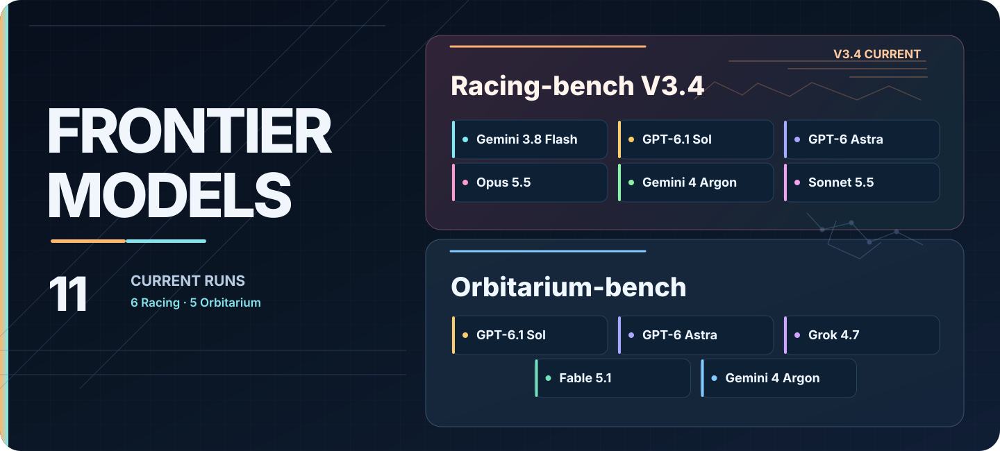

<div align="center">



<br/>

[](./benchmarks)
[](./docs/REPOSITORY-ARCHITECTURE.md)
[](./benchmarks/racing/RUNS.json)

# Frontier Models

**Prompts exatos. Proveniência fixada. Snapshots completos dos projetos. Evidências explícitas.**

[](./README.md)

[Abrir Racing-bench](./benchmarks/racing/) · [Abrir Orbitarium-bench](./benchmarks/solar-system/) · [Metodologia](./docs/METHODOLOGY.md)

</div>

## ⚔️ Execuções atuais por benchmark

### Racing-bench V3.4 — versão atual, focada na corrida

| Modelo atual | Jogar | Código-fonte |
| --- | --- | --- |
| **Gemini 3.8 Flash (V3.4)** | [Jogar](https://racing-gemini-3.8-flash.biel.dev.br/) | [Gemini 3.8 Flash](./benchmarks/racing/runs/gemini-3.8-v3.4/source/) |
| **GPT-6.1 Sol (V3.4)** | [Jogar](https://racing-gpt-6.1-sol.biel.dev.br/) | [GPT-6.1 Sol](./benchmarks/racing/runs/gpt-6.1-sol-v3.4/source/) |
| **GPT-6 Astra (V3.4)** | [Jogar](https://racing-gpt-6-astra.biel.dev.br/) | [GPT-6 Astra](./benchmarks/racing/runs/gpt-6-astra-v3.4/source/) |
| **Opus 5.5 (V3.4)** | [Jogar](https://racing-opus-5.5.biel.dev.br/) | [Opus 5.5](./benchmarks/racing/runs/opus-5.5-v3.4/source/) |
| **Gemini 4 Argon (V3.4)** | [Jogar](https://racing-gemini-4-argon.biel.dev.br/) | [Gemini 4 Argon](./benchmarks/racing/runs/gemini-4-argon-v3.4/source/) |

**Entradas V3.4:** [Prompt](./benchmarks/racing/prompts/racing-v3.4/racing-v3.4.md) · [14 imagens](./benchmarks/racing/prompts/racing-v3.4/refs/) · [Anexo operacional](./benchmarks/racing/EXECUTION-ADDENDUM.md).

**Arquivo Racing V2.6:** [GPT-6.1 Sol](./benchmarks/racing/runs/gpt-6.1-sol/source/), [Gemini 3.8 Flash](./benchmarks/racing/runs/gemini-3.8-flash/source/) e [GPT-6 Astra](./benchmarks/racing/runs/gpt-6-astra/source/).

### Orbitarium-bench — referências atuais

| Modelo | Projeto ao vivo | Código-fonte |
| --- | --- | --- |
| ☀️ **GPT-6.1 Sol** | [Abrir GPT-6.1 Sol](https://orbitarium-gpt-6.1-sol.biel.dev.br) | [Código: GPT-6.1 Sol](./benchmarks/solar-system/runs/gpt-6.1-sol/source/) |
| ✦ **GPT-6 Astra** | [Abrir GPT-6 Astra](https://orbitarium-gpt-6-astra.biel.dev.br) | [Código: GPT-6 Astra](./benchmarks/solar-system/runs/gpt-6-astra-max/frontier-v2/) |
| 𝕏 **Grok 4.7** | [Abrir Grok 4.7](https://orbitarium-grok-4.7.biel.dev.br) | [Código: Grok 4.7](./benchmarks/solar-system/runs/grok-4.7/source/) |
| ◆ **Fable 5.1** | [Abrir Fable 5.1](https://fable-solar-system.vercel.app) | [Código: Fable 5.1](./benchmarks/solar-system/runs/fable/frontier-v2/) |
| ◈ **Gemini 4 Argon** | [Abrir Gemini 4 Argon](https://orbitarium-gemini-4-argon.biel.dev.br) | [Código: Gemini 4 Argon](./benchmarks/solar-system/runs/gemini-4-argon/source/) |

## Como se organiza

```text
FRONTIER MODELS                         2 benchmarks · 10 execuções atuais
│
├── RACING-BENCH (V3.4)                 5 execuções atuais
│   ├── entradas    racing-v3.4/ · 14 referências visuais
│   ├── atuais      Gemini 3.8 Flash · GPT-6.1 Sol · GPT-6 Astra · Opus 5.5 · Gemini 4 Argon
│   └── histórico   execuções V2.6 + prompts anteriores
│
├── ORBITARIUM-BENCH (Frontier V2)      5 referências atuais
│   ├── entradas    frontier-v2.md
│   ├── atuais      Sol · Astra · Grok · Fable · Argon
│   └── histórico   execuções antigas e não frontier
│
└── ORGANIZAÇÃO DO ACERVO (por benchmark)
    ├── RUNS.json   índice atual / histórico + links
    ├── prompts/    entradas originais
    ├── runs/       snapshots de código ou fontes fixadas
    └── proveniência commits · manifests SHA-256 · status dos prompts
```

Explore a [arquitetura do repositório](./docs/REPOSITORY-ARCHITECTURE.md) e as pastas dos benchmarks.

## 🗂️ Outros projetos do Orbitarium

Execuções anteriores e referências fora da arena atual.

| Modelo | Categoria | Site | Código / registro |
| --- | --- | --- | --- |
| ☀️ **GPT-5.6 Sol V1** | Histórico | — | [Código](./benchmarks/solar-system/runs/gpt-5.6-sun-max/original/) |
| ☀️ **GPT-5.6 Sol V2** | Desatualizado | [Abrir](https://orbitarium-gpt-5.6-sol-v2.biel.dev.br) | [Código](./benchmarks/solar-system/runs/gpt-5.6-sun-max/rebuild/) |
| 🌙 **GPT-5.6 Luna** | Não frontier | [Abrir](https://orbitarium-gpt-5.6-luna.biel.dev.br) | [Registro](./benchmarks/solar-system/RUN-PROVENANCE.md) |
| 𝕏 **Grok 4.6** | Arquivado | [Abrir](https://grok-4-6-solar-system.vercel.app) | [Código](./benchmarks/solar-system/runs/grok-4.6/frontier-v2/) |
| ◈ **Gemini 3.8 Flash** | Arquivado | [Abrir](https://orbitarium-gemini-3.8-flash.biel.dev.br) | [Registro](./benchmarks/solar-system/GEMINI-3.8-FLASH-PROVENANCE.md) |

## O que é Frontier Models?

**Frontier Models** é um arquivo de benchmarks para comparar sistemas de IA frontier em projetos completos e inspecionáveis, com prompts, código e proveniência verificáveis.

```text
PROMPT → EXECUÇÃO DO MODELO → SNAPSHOT / FONTE FIXADA → EVIDÊNCIAS → PROVENIÊNCIA → PROJETOS INSPECIONÁVEIS
```

[Registros Racing](./benchmarks/racing/RUN-PROVENANCE.md) · [Registros Orbitarium](./benchmarks/solar-system/RUN-PROVENANCE.md) · [Política do arquivo](./docs/ARCHIVE-POLICY.md).

## Benchmark 002 — Racing-bench

[Prompt Racing V3.4](./benchmarks/racing/prompts/racing-v3.4/racing-v3.4.md) · [14 referências visuais](./benchmarks/racing/prompts/racing-v3.4/refs/) · [Projetos e código](./benchmarks/racing/README-PT-BR.md).

Prompts anteriores: [V3.3](./benchmarks/racing/prompts/racing-v3.3.md), [V3.2](./benchmarks/racing/prompts/racing-v3.2.md), [V3.1](./benchmarks/racing/prompts/racing-v3.1.md) e [V2.6](./benchmarks/racing/prompts/racing-v2.6.md).

## Benchmark 001 — Orbitarium-bench

O Orbitarium-bench pede a cada modelo que construa um produto completo e interativo do Sistema Solar a partir de uma especificação extensa. Ele testa design de produto, simulação e lógica orbital, câmera/navegação, estado temporal, acessibilidade, desempenho, robustez, honestidade científica, ferramentas educacionais e QA.

---

<div align="center">

### Frontier Models

**Entrada · resultado · evidência · comparação — tudo em um só lugar.**

<sub>Arquivo independente de benchmark. Os nomes dos modelos identificam os sistemas usados em cada execução.</sub>

</div>
