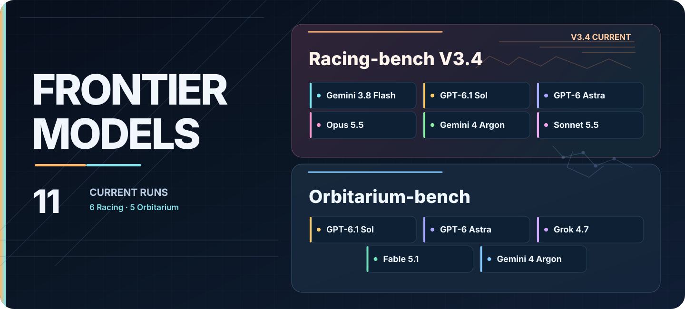

<div align="center">



<br/>

[](./benchmarks)
[](./docs/REPOSITORY-ARCHITECTURE.md)
[](./benchmarks/racing/RUNS.json)

# Frontier Models

**Exact prompts. Pinned provenance. Complete project snapshots. Explicit evidence.**

[-2563EB?style=flat)](./README-PT-BR.md)

[Open Racing-bench](./benchmarks/racing/) · [Open Orbitarium-bench](./benchmarks/solar-system/) · [Methodology](./docs/METHODOLOGY.md)

</div>

## ⚔️ Current benchmark runs

### Racing-bench V3.4 — current race-first benchmark

| Current model | Play | Source code |
| --- | --- | --- |
| **Gemini 3.8 Flash (V3.4)** | [Play racing](https://racing-gemini-3.8-flash.biel.dev.br/) | [Source — gemini-3.8](https://github.com/bielxdh3/gemini-3.8) |
| **GPT-6.1 Sol (V3.4)** | [Play racing](https://racing-gpt-6.1-sol.biel.dev.br/) | [Source — archived here](./benchmarks/racing/runs/gpt-6.1-sol-v3.4/source/) |
| **GPT-6 Astra (V3.4)** | [Play racing](https://racing-gpt-6-astra.biel.dev.br/) (HTTP 404 on Nov 5) | [Source — archived here](./benchmarks/racing/runs/gpt-6-astra-v3.4/source/) |
| **Opus 5.5 (V3.4)** | Site pending — no URL yet | [Source — archived here](./benchmarks/racing/runs/opus-5.5-v3.4/source/) |

**V3.4 inputs:** [Racing prompt](./benchmarks/racing/prompts/racing-v3.4/racing-v3.4.md) · [14 reference images](./benchmarks/racing/prompts/racing-v3.4/refs/). **Source provenance:** [Gemini 3.8 Flash](./benchmarks/racing/runs/gemini-3.8-v3.4/SOURCE-PROVENANCE.md) · [GPT-6.1 Sol](./benchmarks/racing/runs/gpt-6.1-sol-v3.4/SOURCE-PROVENANCE.md) · [GPT-6 Astra](./benchmarks/racing/runs/gpt-6-astra-v3.4/SOURCE-PROVENANCE.md) · [Opus 5.5](./benchmarks/racing/runs/opus-5.5-v3.4/SOURCE-PROVENANCE.md).

**GPT-6 Astra V3.4:** The [upstream report](https://github.com/bielxdh3/6-astra/blob/daf0099699a0e8201b8bc4f1dca6909f92700b3b/verification/REPORT.md) records 33/34 automated checks passed, but the **overall benchmark failed** (High preset below 60 FPS); visual gates P2–P4 were not demonstrated as passed. The owner-provided game URL returned HTTP 404 on November 5, 2026.

**Racing V2.6 archive:** [GPT-6.1 Sol](./benchmarks/racing/runs/gpt-6.1-sol/source/), [Gemini 3.8 Flash](./benchmarks/racing/runs/gemini-3.8-flash/source/) and [GPT-6 Astra](./benchmarks/racing/runs/gpt-6-astra/source/).

### Orbitarium-bench — current references

| Model | Live project | Source code |
| --- | --- | --- |
| ☀️ **GPT-6.1 Sol** | [Open GPT-6.1 Sol](https://orbitarium-gpt-6.1-sol.biel.dev.br) | [Code: GPT-6.1 Sol](./benchmarks/solar-system/runs/gpt-6.1-sol/source/) |
| ✦ **GPT-6 Astra** | [Open GPT-6 Astra](https://orbitarium-gpt-6-astra.biel.dev.br) | [Code: GPT-6 Astra](./benchmarks/solar-system/runs/gpt-6-astra-max/frontier-v2/) |
| 𝕏 **Grok 4.7** | [Open Grok 4.7](https://orbitarium-grok-4.7.biel.dev.br) | [Code: Grok 4.7](./benchmarks/solar-system/runs/grok-4.7/source/) |
| ◆ **Fable 5.1** | [Open Fable 5.1](https://fable-solar-system.vercel.app) | [Code: Fable 5.1](./benchmarks/solar-system/runs/fable/frontier-v2/) |
| ◈ **Gemini 4 Argon** | [Open Gemini 4 Argon](https://orbitarium-gemini-4-argon.biel.dev.br) | [Code: Gemini 4 Argon](./benchmarks/solar-system/runs/gemini-4-argon/source/) |

Orbitarium includes **five current references**. Gemini 4 Argon and GPT-6.1 Sol are archived at exact source commits, but their generating prompts are not independently verified, so Frontier V2 prompt equivalence is not claimed. Gemini 3.8 Flash remains a **historical Orbitarium** source-pinned reference and its V2.6 Racing project is also **legacy/archived**.

## How it fits together

```text
FRONTIER MODELS                         2 benchmarks · 9 current runs
│
├── RACING-BENCH (V3.4)                 4 current runs
│   ├── inputs      racing-v3.4/ · 14 visual references
│   ├── current     Gemini 3.8 Flash · GPT-6.1 Sol · GPT-6 Astra · Opus 5.5
│   └── history     V2.6 runs + earlier prompts
│
├── ORBITARIUM-BENCH (Frontier V2)      5 current references
│   ├── inputs      frontier-v2.md
│   ├── current     Sol · Astra · Grok · Fable · Argon
│   └── history     earlier and non-frontier runs
│
└── ARCHIVE CONVENTIONS (per benchmark)
    ├── RUNS.json   current / historical index + live URLs
    ├── prompts/    original benchmark inputs
    ├── runs/       source snapshots or commit-pinned records
    └── provenance commits · SHA-256 manifests · prompt status
```

Each benchmark has its own prompts, current runs and history, indexed in `RUNS.json`. Source snapshots, commit pins and provenance stay separate from public links. See [repository architecture](./docs/REPOSITORY-ARCHITECTURE.md).

## 🗂️ Non-frontier or outdated models

These **Orbitarium** runs stay visible for reference but are separated from that benchmark's current arena. Racing-bench V3.4 features Gemini 3.8 Flash, GPT-6.1 Sol and GPT-6 Astra; the three V2.6 projects remain legacy archives.

| Model | Classification | Project / source | Provenance |
| --- | --- | --- | --- |
| ☀️ **GPT-5.6 Sol V1** | Historical baseline | Site removed | [Archive V1](./benchmarks/solar-system/runs/gpt-5.6-sun-max/original/) · commit `67eb9fc51f…` |
| ☀️ **GPT-5.6 Sol V2** | Outdated frontier run | [Open Sol V2](https://orbitarium-gpt-5.6-sol-v2.biel.dev.br) | [Archive V2](./benchmarks/solar-system/runs/gpt-5.6-sun-max/rebuild/) · commit `93d43ae62f…` |
| 🌙 **GPT-5.6 Luna** | Non-frontier | [Open Luna](https://orbitarium-gpt-5.6-luna.biel.dev.br) | commit [`5fdc036884…`](https://github.com/bielxdh3/orbitario-luna/commit/5fdc036884bbeb712eb015c76db1b1eaf83c9e42) |
| 𝕏 **Grok 4.6** | Archived frontier run | [Open Grok 4.6](https://grok-4-6-solar-system.vercel.app) | [`runs/grok-4.6/frontier-v2`](./benchmarks/solar-system/runs/grok-4.6/frontier-v2/) |
| ◈ **Gemini 3.8 Flash** | Archived Frontier V2 | [Open Gemini 3.8 Flash](https://orbitarium-gemini-3.8-flash.biel.dev.br) | [`source-pinned reference`](./benchmarks/solar-system/GEMINI-3.8-FLASH-PROVENANCE.md) · `805cfe87a…` |

Luna is currently source-pinned only; its prompt provenance is not archived in this repository.

## What is Frontier Models?

**Frontier Models** is a benchmark archive for comparing frontier AI systems on complete, inspectable projects with verified prompts, source snapshots and provenance.

```text
PROMPT → MODEL RUN → PROJECT SNAPSHOT / PINNED SOURCE → EVIDENCE → PROVENANCE → INSPECTABLE PROJECTS
```

## Benchmark 002 — Racing-bench

**[V3.4 prompt](./benchmarks/racing/prompts/racing-v3.4/racing-v3.4.md)** · [14 visual references](./benchmarks/racing/prompts/racing-v3.4/refs/). Play [Gemini 3.8 Flash](https://racing-gemini-3.8-flash.biel.dev.br/) or [GPT-6.1 Sol](https://racing-gpt-6.1-sol.biel.dev.br/); the owner also provided an [Astra V3.4 game URL](https://racing-gpt-6-astra.biel.dev.br/) (returned HTTP 404 on November 5). [Opus 5.5](./benchmarks/racing/runs/opus-5.5-v3.4/source/) is archived but its site is not yet published. Inspect the [GPT-6 Astra V3.4 archive](./benchmarks/racing/runs/gpt-6-astra-v3.4/source/) and [Racing source archive](./benchmarks/racing/README.md).

Previous prompts: [V3.3](./benchmarks/racing/prompts/racing-v3.3.md), [V3.2](./benchmarks/racing/prompts/racing-v3.2.md), [V3.1](./benchmarks/racing/prompts/racing-v3.1.md) and [V2.6](./benchmarks/racing/prompts/racing-v2.6.md).

## Benchmark 001 — Orbitarium-bench

Orbitarium-bench asks each model to build a complete interactive Solar System product from a dense product specification. It stresses product design, simulation and orbital logic, camera/navigation, time state, accessibility, performance, robustness, scientific honesty, learning tools and QA.

The historical archive path `benchmarks/solar-system/` is preserved to keep existing links and exact-source provenance stable.

## Run provenance by benchmark

### Racing-bench

| Model | Source revision | Classification | Source status |
| --- | --- | --- | --- |
| **GPT-6.1 Sol** | Git `6f55263669…` | Legacy | Archived |
| **Gemini 3.8 Flash** | Git `a18fcaee71…` | Legacy | Archived |
| **GPT-6 Astra** | Git `0c615e8dc3…` | Legacy | Archived |
| **Gemini 3.8 Flash** | Git `8f1992b88c…` | Current | Archived |
| **GPT-6.1 Sol** | Git `1ab34b18cb…` | Current | Archived |
| **GPT-6 Astra** | Git `daf0099699…` | Current | Archived |
| **Opus 5.5** | Git `e75f298d49…` | Current | Archived; site pending |

Archive details and hashes are recorded in [Racing-bench](./benchmarks/racing/README.md).

### Orbitarium-bench

| Model | Source revision | Classification | Source status |
| --- | --- | --- | --- |
| **GPT-6.1 Sol** | Git `7caaccc7f4…` | Current | Archived |
| **GPT-6 Astra** | Git `fca2ef51b4…` | Current | Archived |
| **Grok 4.7** | Git `bcb1e82012…` | Current | Archived |
| **Fable 5.1** | Git `7e079669e4…` | Current | Archived |
| **Gemini 4 Argon** | Git `318aa80bb5…` | Current | Archived |
| **GPT-5.6 Sol V1** | Git `67eb9fc51f…` | Historical | Archived |
| **GPT-5.6 Sol V2** | Git `93d43ae62f…` | Historical | Archived |
| **Grok 4.6** | ZIP SHA-256 `5d77eeb509…` | Historical | Archived |
| **Gemini 3.8 Flash** | Git `805cfe87a6…` | Historical | Pinned only |
| **GPT-5.6 Luna** | Git `5fdc036884…` | Non-frontier | Pinned only |

**Classification** refers to the run's status *within its benchmark*: Current, Historical (including superseded/archived runs), or Non-frontier. **Source status** refers only to source-file preservation: Archived (local snapshot) or Pinned only (source revision recorded, without a full local snapshot). It does not assert prompt equivalence or gameplay quality.

The exact shared Orbitarium prompt is [`frontier-v2.md`](./benchmarks/solar-system/prompts/frontier-v2.md), SHA-256 `7c2833a0486938c38671139807bd4a8c16371c3740175376ad02a6c0c3c06d65`.

## Archive policy

- model output stays untouched inside archived `runs/` snapshots;
- archive metadata stays outside model output;
- exact prompts are archived separately and verbatim;
- Git commits are used when source Git metadata exists;
- cryptographic source-archive hashes are used when it does not;
- a source repository may be commit-pinned while its vendored snapshot is still pending;
- historical runs remain preserved without cluttering the current arena.

---

<div align="center">

### Frontier Models

**Input · output · evidence · comparison — in one place.**

<sub>Independent benchmark archive. Model names identify the systems used for individual runs.</sub>

</div>
