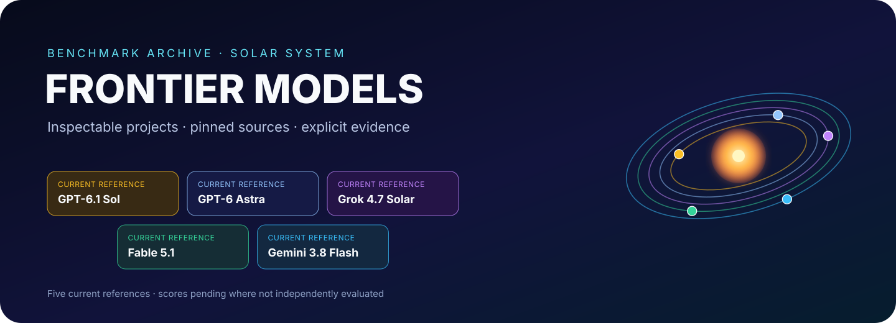
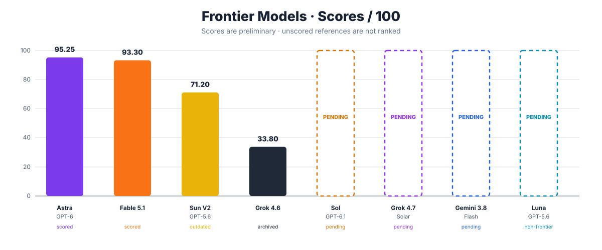

<div align="center">



<br/>

[](./benchmarks)
[](./benchmarks/solar-system/RUNS.json)
[](./benchmarks/solar-system/RUNS.json)

# Frontier Models

**Exact prompts. Pinned provenance. Complete project snapshots. Explicit evidence.**

[-2563EB?style=flat)](./README-PT-BR.md)

[Open benchmark](./benchmarks/solar-system/) · [Methodology](./docs/METHODOLOGY.md)

</div>

## ⚔️ Frontier V2 live arena

| Model | Run / provenance | Live project | Archived / pinned run |
| --- | --- | --- | --- |
| ☀️ **GPT-6.1 Sol** | Source-archived / prompt unverified | [Source project](https://github.com/bielxdh3/6.1gptsol) | [`runs/gpt-6.1-sol/source`](./benchmarks/solar-system/runs/gpt-6.1-sol/source/) |
| ✦ **GPT-6 Astra** | Frontier V2 | [Open Astra](https://gpt-6-astra.biel.dev.br) | [`runs/gpt-6-astra-max/frontier-v2`](./benchmarks/solar-system/runs/gpt-6-astra-max/frontier-v2/) |
| 𝕏 **Grok 4.7 Solar** | Source-pinned reference | [Open Solar System Observatory](https://grok-4.7.biel.dev.br/) | [`runs/grok-4.7/source`](./benchmarks/solar-system/runs/grok-4.7/source/) |
| ◆ **Fable 5.1** | Frontier V2 | [Open Fable 5.1](https://fable-solar-system.vercel.app) | [`runs/fable/frontier-v2`](./benchmarks/solar-system/runs/fable/frontier-v2/) |
| ◈ **Gemini 3.8 Flash** | Frontier V2 | [Open Gemini 3.8 Flash](https://gemini-3.8-flash.biel.dev.br) | [`runs/gemini-3.8-flash/frontier-v2`](./benchmarks/solar-system/runs/gemini-3.8-flash/frontier-v2/) |

The current arena includes **five** references. GPT-6.1 Sol is fully source-archived at an exact commit; its generating prompt has not been independently verified, so no Frontier V2 prompt equivalence or score is claimed. Grok 4.7 Solar is also source-archived without verified prompt provenance.

## 🗂️ Non-frontier or outdated models

These runs stay visible for reference, but they are intentionally separated from the current frontier arena and hero graphic. The arena classification is separate from the score overview: scored historical/outdated runs remain visible there, while unevaluated runs stay unranked.

| Model | Classification | Project / source | Provenance | Score status |
| --- | --- | --- | --- | --- |
| ☀️ **GPT-5.6 Sun V1** | Historical baseline | [Open Sun V1](https://gpt-5.6-sun-v1.biel.dev.br) | [`runs/gpt-5.6-sun-max/original`](./benchmarks/solar-system/runs/gpt-5.6-sun-max/original/) · commit `67eb9fc51f…` | **Not ranked** · different prompt |
| ☀️ **GPT-5.6 Sun V2** | Outdated frontier run | [Open Sun V2](https://gpt-5.6-sun-v2.biel.dev.br) | [`runs/gpt-5.6-sun-max/rebuild`](./benchmarks/solar-system/runs/gpt-5.6-sun-max/rebuild/) · commit `93d43ae62f…` | **71.20/100** historical |
| 🌙 **GPT-5.6 Luna** | Non-frontier | [Open Luna](https://gpt-5.6-luna.biel.dev.br) · [Source repository](https://github.com/bielxdh3/orbitario-luna) | commit [`5fdc036884…`](https://github.com/bielxdh3/orbitario-luna/commit/5fdc036884bbeb712eb015c76db1b1eaf83c9e42) | **Pending evaluation** |
| 𝕏 **Grok 4.6** | Archived frontier run | [Open Grok 4.6](https://grok-4-6-solar-system.vercel.app) | [`runs/grok-4.6/frontier-v2`](./benchmarks/solar-system/runs/grok-4.6/frontier-v2/) | **33.80/100** historical |

Luna is currently source-pinned only; its prompt provenance is not archived in this repository.

## What is Frontier Models?

**Frontier Models** is a benchmark archive for comparing frontier AI systems on complete, inspectable projects rather than isolated screenshots or synthetic scores.

```text
PROMPT → MODEL RUN → PROJECT SNAPSHOT / PINNED SOURCE → EVIDENCE → SCORECARD → VERDICT
```

## Benchmark 001 — Solar System / Orbitarium

The first benchmark asks each model to build a complete interactive Solar System product from a dense product specification. It stresses product design, simulation and orbital logic, camera/navigation, time state, accessibility, performance, robustness, scientific honesty, learning tools and QA.

## Run provenance

| Model | Provenance | Classification | Source status |
| --- | --- | --- | --- |
| GPT-6.1 Sol | source commit [`7caaccc7f4…`](https://github.com/bielxdh3/6.1gptsol/commit/7caaccc7f462806de10a1981c9826d3151e85407) | Current reference | Archived; prompt unverified |
| GPT-6 Astra | commit `fca2ef51b4…` | Current frontier | Archived |
| Grok 4.7 Solar | commit `bcb1e82012…` in `JouberthAlves/grok-4.7-solar` | Current frontier | Source pinned |
| Fable 5.1 | commit `7e079669e41b…` | Current frontier | Archived |
| Gemini 3.8 Flash | commit `805cfe87a…` in `bielxdh3/gemini` | Current frontier | Source pinned |
| GPT-5.6 Sun V1 | commit `67eb9fc51f…` | Historical baseline | Archived |
| GPT-5.6 Sun V2 | commit `93d43ae62f…` | Outdated | Archived |
| Grok 4.6 | source ZIP SHA-256 `5d77eeb509…` | Archived frontier | Archived |
| GPT-5.6 Luna | commit `5fdc036884…` in `bielxdh3/orbitario-luna` | Non-frontier | Source pinned |

The exact shared prompt is [`frontier-v2.md`](./benchmarks/solar-system/prompts/frontier-v2.md), SHA-256 `7c2833a0486938c38671139807bd4a8c16371c3740175376ad02a6c0c3c06d65`.

## Benchmark scores

> **Preliminary evaluation:** the current scores are mainly based on one evaluator and a limited number of devices/environments. GPT-6.1 Sol, Grok 4.7 Solar, Gemini 3.8 Flash and GPT-5.6 Luna are **not scored yet**. Pending is not zero; Sun V2 remains visible with its historical score even though it is no longer in the frontier arena.

<div align="center">



</div>

| Rank | Model | Score |
| ---: | --- | ---: |
| **1** | GPT-6 Astra | **95.25/100** |
| **2** | Fable 5.1 | **93.30/100** |
| **3** | GPT-5.6 Sun V2 | **71.20/100** |
| **4** | Grok 4.6 | **33.80/100** |
| — | GPT-6.1 Sol | **Pending** |
| — | Grok 4.7 Solar | **Pending** |
| — | Gemini 3.8 Flash | **Pending** |
| — | GPT-5.6 Luna | **Pending** |

## Evaluation criteria — summary

- **Feature completeness — 20 pts:** required features must actually exist and deliver the intended behavior; fake, shallow or loophole-driven implementations lose credit.
- **Interaction / UX — 15 pts:** clarity, discoverability, ergonomics and control flow when the product is working as designed; implementation bugs do **not** automatically count as UX problems.
- **Visual execution — 15 pts:** hierarchy, readability, coherence, rendering quality and polish.
- **Scientific / simulation fidelity — 15 pts:** orbital, temporal, scale and astronomical correctness, including honest approximation boundaries.
- **Robustness — 10 pts:** bugs, state desynchronization, broken camera/follow behavior, exceptions, corrupted state and features that stop working.
- **Performance — 10 pts:** responsiveness, frame pacing, loading and resource efficiency.
- **Code / architecture — 10 pts:** maintainability, modularity, state boundaries, dependencies, testability and validation quality.
- **Accessibility / responsive behavior — 5 pts:** keyboard/focus access, reduced motion, semantic usability and layout adaptation across target viewports.

**No double penalty:** one defect should be charged to its primary category unless independent evidence shows a separate violation. Example: if the Sun follows the camera/user because scene or follow state is broken, that is **Robustness**, not UX.

See the detailed evidence and per-category scores in [`SCORECARD.md`](./benchmarks/solar-system/comparison/SCORECARD.md).

## Archive policy

- model output stays untouched inside archived `runs/` snapshots;
- evaluator material stays outside model output;
- exact prompts are archived separately and verbatim;
- Git commits are used when source Git metadata exists;
- cryptographic source-archive hashes are used when it does not;
- a source repository may be commit-pinned while its vendored snapshot is still pending;
- historical runs remain preserved without cluttering the current arena.

---

<div align="center">

### Frontier Models

**Input · output · evidence · comparison — in one place.**

<sub>Independent benchmark archive. Model names identify the systems used for individual runs.</sub>

</div>
