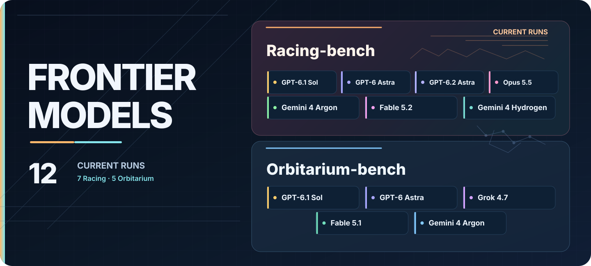

<div align="center">



<br/>

[](./benchmarks)
[](./docs/REPOSITORY-ARCHITECTURE.md)
[](./benchmarks/racing/RUNS.json)

# Frontier Models

**Exact prompts. Pinned provenance. Complete project snapshots. Explicit evidence.**

[-2563EB?style=flat)](./README-PT-BR.md)

[Open Racing-bench](./benchmarks/racing/) · [Open Orbitarium-bench](./benchmarks/solar-system/) · [Methodology](./docs/METHODOLOGY.md)

**Website:** [frontier-models-ui.vercel.app](https://frontier-models-ui.vercel.app) — browse every current run and compare the Racing scenes side by side.

</div>

## ⚔️ Current benchmark runs

### Racing-bench V3.4 / V3.4.1 — current race-first benchmark

| Current model | Play | Source code | Tokens | Time |
| --- | --- | --- | ---: | ---: |
| ☀️ **GPT-6.1 Sol** | [Play racing](https://racing-gpt-6.1-sol.biel.dev.br/) | [GPT-6.1 Sol](./benchmarks/racing/runs/gpt-6.1-sol-v3.4/source/) | — | — |
| ✦ **GPT-6.2 Astra (V3.4.1)** | [Play racing](https://racing-gpt-6.2-astra.biel.dev.br/) | [GPT-6.2 Astra (V3.4.1)](./benchmarks/racing/runs/gpt-astra-6.2-v3.4.1/source/) | 21.55%\* | ~5h |
| ♬ **Opus 5.5** | [Play racing](https://racing-opus-5.5.biel.dev.br/) | [Opus 5.5](./benchmarks/racing/runs/opus-5.5-v3.4/source/) | — | — |
| ✧ **Fable 5.2 (V3.4.1)** | [Play racing](https://racing-fable-5.2.biel.dev.br/) | [Fable 5.2 (V3.4.1)](./benchmarks/racing/runs/fable-5.2-v3.4.1/source/) | ~475.74M | ~11h |
| ◈ **Gemini 4 Argon** | [Play racing](https://racing-gemini-4-argon.biel.dev.br/) | [Gemini 4 Argon](./benchmarks/racing/runs/gemini-4-argon-v3.4/source/) | — | — |
| ⬡ **Gemini 4 Hydrogen** | [Play racing](https://racing-gemini-4-hydrogen.biel.dev.br/) | [Gemini 4 Hydrogen](./benchmarks/racing/runs/gemini-4-hydrogen-v3.4/source/) | — | — |

*Since V3.4.1: total tokens (including cache) and estimated active execution time, when available. — = not recorded. [Metrics and limitations](./benchmarks/racing/EXECUTION-METRICS.md).*

\* GPT-6.2 Astra: 21.55% of the Plus weekly quota (whole chat; 98% Astra model share).

**V3.4 inputs:** [Racing prompt](./benchmarks/racing/prompts/racing-v3.4/racing-v3.4.md) · [14 reference images](./benchmarks/racing/prompts/racing-v3.4/refs/) · [Operational addendum](./benchmarks/racing/EXECUTION-ADDENDUM.md).

**Fable 5.2 input:** [V3.4.1](./benchmarks/racing/prompts/racing-v3.4/racing-v3.4.1.md).

**Upcoming runs — V3.5:** [Prompt](./benchmarks/racing/prompts/racing-v3.5/racing_bench_v3_5.md) · [14 references](./benchmarks/racing/prompts/racing-v3.5/refs/). No V3.5 results recorded yet.

**Racing V2.6 archive:** [Historical runs and source](./benchmarks/racing/README.md).

### Orbitarium-bench — current references

| Model | Live project | Source code |
| --- | --- | --- |
| ☀️ **GPT-6.1 Sol** | [Open GPT-6.1 Sol](https://orbitarium-gpt-6.1-sol.biel.dev.br) | [Code: GPT-6.1 Sol](./benchmarks/solar-system/runs/gpt-6.1-sol/source/) |
| ✦ **GPT-6 Astra** | [Open GPT-6 Astra](https://orbitarium-gpt-6-astra.biel.dev.br) | [Code: GPT-6 Astra](./benchmarks/solar-system/runs/gpt-6-astra-max/frontier-v2/) |
| 𝕏 **Grok 4.7** | [Open Grok 4.7](https://orbitarium-grok-4.7.biel.dev.br) | [Code: Grok 4.7](./benchmarks/solar-system/runs/grok-4.7/source/) |
| ◆ **Fable 5.1** | [Open Fable 5.1](https://fable-solar-system.vercel.app) | [Code: Fable 5.1](./benchmarks/solar-system/runs/fable/frontier-v2/) |
| ◈ **Gemini 4 Argon** | [Open Gemini 4 Argon](https://orbitarium-gemini-4-argon.biel.dev.br) | [Code: Gemini 4 Argon](./benchmarks/solar-system/runs/gemini-4-argon/source/) |

## How it fits together

```text
FRONTIER MODELS                         2 benchmarks · 11 current runs
│
├── RACING-BENCH (V3.4 / V3.4.1)                 6 current runs
│   ├── inputs      racing-v3.4/ · 14 visual references
│   ├── current     GPT-6.1 Sol · GPT-6.2 Astra (V3.4.1) · Opus 5.5 · Gemini 4 Argon · Fable 5.2 (V3.4.1) · Gemini 4 Hydrogen
│   └── history     V2.6 runs + earlier prompts
│
├── ORBITARIUM-BENCH (Frontier V2)      5 current references
│   ├── inputs      frontier-v2.md
│   ├── current     Sol · Astra · Grok · Fable · Argon
│   └── history     earlier and non-frontier runs
│
└── ARCHIVE CONVENTIONS (per benchmark)
    ├── RUNS.json   current / historical index + live URLs
    ├── prompts/    original benchmark inputs
    ├── runs/       source snapshots or commit-pinned records
    └── provenance commits · SHA-256 manifests · prompt status
```

Browse [repository architecture](./docs/REPOSITORY-ARCHITECTURE.md) and the benchmark folders.

## 🗂️ Non-frontier Racing

| Model | Category | Website | Source code |
| --- | --- | --- | --- |
| ◈ **Gemini 3.8 Flash** | Non-frontier | Deleted | [Code](./benchmarks/racing/runs/gemini-3.8-v3.4/source/) |
| ✧ **Sonnet 5.5** | Non-frontier | [Play racing](https://racing-sonnet-5.5.biel.dev.br/) | [Sonnet 5.5](./benchmarks/racing/runs/sonnet-5.5-v3.4/source/) |
| ✦ **GPT-6 Astra** | Non-frontier | [Play racing](https://racing-gpt-6-astra.biel.dev.br/) | [GPT-6 Astra](./benchmarks/racing/runs/gpt-6-astra-v3.4/source/) |

## 🗂️ Other Orbitarium projects

Earlier runs and references outside the current arena.

| Model | Category | Website | Source / record |
| --- | --- | --- | --- |
| ☀️ **GPT-5.6 Sol V1** | Historical | Deleted | [Code](./benchmarks/solar-system/runs/gpt-5.6-sun-max/original/) |
| ☀️ **GPT-5.6 Sol V2** | Outdated | [Open](https://orbitarium-gpt-5.6-sol-v2.biel.dev.br) | [Code](./benchmarks/solar-system/runs/gpt-5.6-sun-max/rebuild/) |
| 🌙 **GPT-5.6 Luna** | Non-frontier | Deleted | [Record](./benchmarks/solar-system/RUN-PROVENANCE.md) |
| 𝕏 **Grok 4.6** | Outdated | [Open](https://grok-4-6-solar-system.vercel.app) | [Code](./benchmarks/solar-system/runs/grok-4.6/frontier-v2/) |
| ◈ **Gemini 3.8 Flash** | Non-frontier | Deleted | [Record](./benchmarks/solar-system/GEMINI-3.8-FLASH-PROVENANCE.md) |

## What is Frontier Models?

**Frontier Models** is a benchmark archive for comparing frontier AI systems on complete, inspectable projects with verified prompts, source snapshots and provenance.

```text
PROMPT → MODEL RUN → PROJECT SNAPSHOT / PINNED SOURCE → EVIDENCE → PROVENANCE → INSPECTABLE PROJECTS
```

[Racing records](./benchmarks/racing/RUN-PROVENANCE.md) · [Orbitarium records](./benchmarks/solar-system/RUN-PROVENANCE.md) · [Archive policy](./docs/ARCHIVE-POLICY.md).

## Benchmark 002 — Racing-bench

[Racing V3.4 prompt](./benchmarks/racing/prompts/racing-v3.4/racing-v3.4.md) · [14 visual references](./benchmarks/racing/prompts/racing-v3.4/refs/) · [Games and source](./benchmarks/racing/README.md).

Previous prompts: [V3.3](./benchmarks/racing/prompts/racing-v3.3.md), [V3.2](./benchmarks/racing/prompts/racing-v3.2.md), [V3.1](./benchmarks/racing/prompts/racing-v3.1.md) and [V2.6](./benchmarks/racing/prompts/racing-v2.6.md).

## Benchmark 001 — Orbitarium-bench

Orbitarium-bench asks each model to build a complete interactive Solar System product from a dense product specification. It stresses product design, simulation and orbital logic, camera/navigation, time state, accessibility, performance, robustness, scientific honesty, learning tools and QA.

---

<div align="center">

### Frontier Models

**Input · output · evidence · comparison — in one place.**

<sub>Independent benchmark archive. Model names identify the systems used for individual runs.</sub>

</div>
