# Solmare — Racing-bench V3.4

**Resultado integral do benchmark: FAIL.** O acabamento visual permanece abaixo das referências comerciais: carrocerias simplificadas, vegetação repetitiva, arquitetura esparsa e água com padrões regulares. Os portões visuais P2–P4 não foram demonstrados como aprovados antes do avanço; a sequência exigida também não foi satisfeita. A RTX 3060 e a GPU integrada exigidas não estavam disponíveis para medição.

Verificação automatizada na máquina disponível: **FAIL** (33/34). Falhas: Measured high/low mean FPS >=60 on available GPU.

As capturas e o vídeo são renderizados pelo jogo; nenhuma referência é incorporada ao cenário ou ao build. O funcionamento completo e os testes numéricos não substituem a aprovação visual.

## Ambiente e desempenho

GPU: ANGLE (NVIDIA, NVIDIA GeForce RTX 3070 Ti (0x00002482) Direct3D11 vs_5_0 ps_5_0, D3D11). CPU: AMD Ryzen 7 5700G with Radeon Graphics         . Navegador: Mozilla/5.0 (Windows NT 10.0; Win64; x64) AppleWebKit/537.36 (KHTML, like Gecko) Chrome/141.0.0.0 Safari/537.36. Resolução: 1920 × 1080.

| Qualidade | FPS médio | 1% low |
| --- | ---: | ---: |
| high | 55.48 | 28.92 |
| low | 91.29 | 50.04 |

As medições acima foram feitas na máquina informada. RTX 3060 e GPU integrada não foram medidas diretamente. O preset Baixa reduz resolução interna, sombras, alcance da vegetação e pós-processamento, preservando modelos e texturas.

## Testes

| Verificação | Resultado |
| --- | --- |
| Garage: two models, six colors and number | PASS |
| Five-second grid plus locked 3-2-1 start | PASS |
| Real keyboard driving | PASS |
| Hood camera toggle | PASS |
| Pause freezes simulation | PASS |
| Resume restores race | PASS |
| 3-lap journey reaches results | PASS |
| 3-lap vehicle integrity | PASS |
| 3-lap AI overtaking and progress | PASS |
| 3-lap camera integrity | PASS |
| 3-lap projected times marked | PASS |
| Retry starts a fresh grid | PASS |
| 6-lap journey reaches results | PASS |
| 6-lap vehicle integrity | PASS |
| 6-lap AI overtaking and progress | PASS |
| 6-lap camera integrity | PASS |
| 6-lap projected times marked | PASS |
| Three restarts do not duplicate voices | PASS |
| Heap stable after three restarts | PASS |
| Menu stops race voices | PASS |
| Shortcut cannot count a lap | PASS |
| World geometry validates | PASS |
| Scene car triangle/material thresholds | PASS |
| Scene box/flat/texture detectors | PASS |
| Scene density and variety | PASS |
| Recorded sample engine connections | PASS |
| S1–S9 numerical image sanity | PASS |
| Every 25m camera sweep image sanity | PASS |
| Measured high/low mean FPS >=60 on available GPU | FAIL |
| Full lap WebM and WAV captured | PASS |
| Master peak <= -1 dBFS | PASS |
| Recorded lap integrity | PASS |
| No runtime browser errors | PASS |
| Offline asset loading: zero external requests | PASS |

Evidências completas: `results.json`, `race-3-laps.json`, `race-6-laps.json`, `scene-stats.json`, `restart-metrics.json`, `sweep-metrics.json` e `logs/`.

## Áudio

Gravação: 125.28 s. Pico medido no master: **-5.179 dBFS**. Máximo de vozes de motor: 6, sendo cinco IAs e um jogador; quatro camadas amostradas por motor.

- shift: 00:01, 00:02, 00:04, 00:07, 00:12, 00:12, 00:12, 00:12.
- skid: 00:12, 00:28, 00:36.
- collision: 00:12, 00:12, 00:12, 00:12, 00:12, 00:12, 00:12, 00:12.
- barrier-contact: não registrado nesta volta.
- bridge: 01:33.
- ai-pass: 00:00, 00:00, 00:11, 00:12, 00:13, 01:03.

O vídeo registra o canvas 3D; o HUD HTML aparece nas screenshots, mas não é composto no WebM. O arquivo MediaRecorder é reproduzível e permite buscar quadros, embora alguns players mostrem duração indefinida no contêiner; a duração PCM foi conferida independentemente em `media-check.json`. Os instantes usam o relógio da corrida; a gravação inclui os oito segundos de apresentação e contagem. A condução de teste inclui uma entrada curta de esterço para exercitar contato e derrapagem usando a física normal.

## Comparações visuais

Cada prancha apresenta a captura do jogo e as referências designadas com o mesmo tamanho de painel. S9–S12 não têm referência designada. As observações abaixo são mantidas após inspeção das imagens.

### S2 — grid-3-4

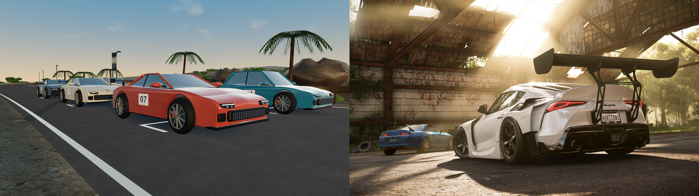

Arquivo: screenshots/s2-grid-3-4-73fps.png. Céu: 35.5%. Luminância média: 0.413; desvio: 0.227.

**Avaliação do veto visual (5.8):** Não há penetração aparente do carro no asfalto, e carroceria e rodas têm volume. O vidro e a lataria continuam visualmente simples e excessivamente uniformes para aprovar P2.

- O carro tem superfície contínua, caixas de roda abertas e pintura com clearcoat; o perfil das laterais e do para-choque é mais simples que o carro da referência 11.
- Rodas, raios, discos e pinças são geometria separada; o pneu tem menos detalhes de sulcos e inscrições laterais que o da referência.
- O vidro reflete o ambiente, mas o interior e os reflexos locais têm menos detalhes. A iluminação do grid é aberta, sem a oclusão arquitetônica da referência.

### S12 — mapa

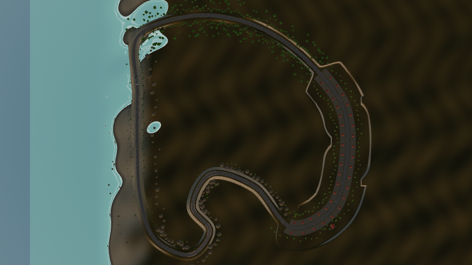

Arquivo: screenshots/s12-mapa-45fps.png. Céu: vista superior. Luminância média: 0.245; desvio: 0.195.

**Avaliação do veto visual (5.8):** A vista superior evidencia repetição de distribuição, grandes áreas uniformes e um limite retangular de cor no mar. Não constitui aprovação artística do circuito.

- Sem referência designada. A vista superior mostra o circuito fechado completo e a transição entre orla, serpentinas, vila e bosque.
- O heightfield mantém continuidade junto à pista, mas a terraplenagem cria faixas largas e regulares ao redor de alguns trechos.
- A distribuição de árvores e casas revela repetição; há uma descontinuidade retangular de cor no mar no limite do mapa de profundidade.

### S1 — reta-orla

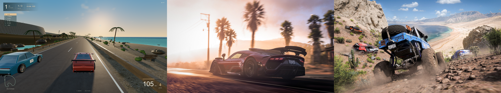

Arquivo: screenshots/s1-reta-orla-100fps.png. Céu: 34.8%. Luminância média: 0.420; desvio: 0.229.

**Avaliação do veto visual (5.8):** Abaixo do alvo: há trechos amplos e pouco detalhados nas margens, além de repetição perceptível dos arbustos. A imagem mostra céu e sombras, mas isso não elimina esses pontos de veto.

- As sombras são longas e há reflexo do sol no asfalto; a referência 01 tem uma névoa dourada mais rica e contraluz mais recortado nas carrocerias.
- As palmeiras do jogo têm folhas geométricas visíveis, mas as copas são mais esparsas e repetem a mesma organização radial.
- A orla tem bancos, cercas, arbustos e rochas; os taludes distantes ainda têm menos variação de relevo e vegetação que a referência 02.

### S3 — praia-espuma

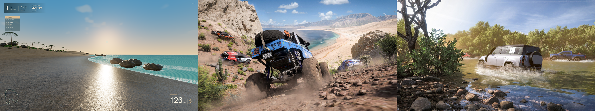

Arquivo: screenshots/s3-praia-espuma-92fps.png. Céu: 46.4%. Luminância média: 0.546; desvio: 0.183.

**Avaliação do veto visual (5.8):** Reprovado pelo padrão repetitivo dominante da água e da espuma. O mar tem relevo de ondas e espuma, mas sua regularidade continua visível.

- Há areia molhada com reflexo, faixa de espuma e rochas na linha d’água; a espuma do jogo ainda aparece como um padrão mais uniforme que as quebras irregulares da referência 04.
- O mar usa várias ondas e brilho especular, mas o padrão de pequenas ondulações ainda se repete e não tem a mesma turbulência junto às pedras.
- A praia é mais ampla e limpa; faltam a densidade de pequenas pedras, raízes e vegetação rasteira que aparece nas referências 02 e 04.

### S8 — disputa

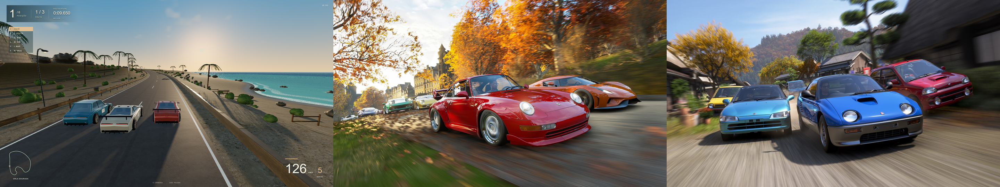

Arquivo: screenshots/s8-disputa-58fps.png. Céu: 34.2%. Luminância média: 0.421; desvio: 0.225.

**Avaliação do veto visual (5.8):** Os três carros estão em linhas distintas, sem sobreposição aparente neste quadro. Persistem as margens esparsas e repetitivas da orla e a simplicidade das carrocerias.

- Os carros disputam linhas distintas com posições vindas da física; o enquadramento de perseguição mostra menos detalhe frontal que as referências 09 e 13.
- Há diferenças de cor e dois perfis de carroceria, mas a variedade de modelos e detalhes externos é menor que a dos carros das referências.
- O desfoque de velocidade é discreto; as referências têm mais borramento direcional do entorno e reflexos locais mais complexos nas latarias.

### S4 — falesia-mirante

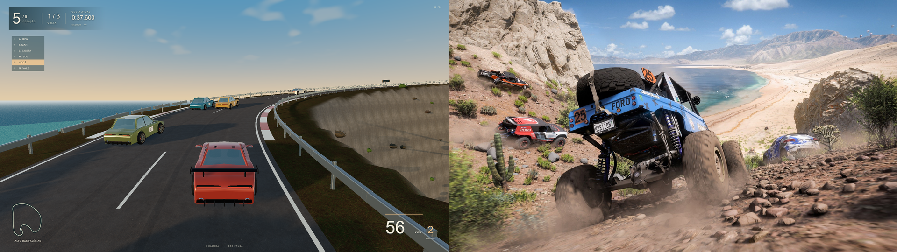

Arquivo: screenshots/s4-falesia-mirante-67fps.png. Céu: 37.4%. Luminância média: 0.400; desvio: 0.231.

**Avaliação do veto visual (5.8):** Abaixo do alvo: o talude tem grandes áreas com poucos detalhes e vegetação esparsa. A estrada acompanha o terreno, mas a margem não tem o acabamento exigido.

- A serpentina tem desnível real, vista do mar e guardrails acompanhando a inclinação; os grandes afloramentos rochosos da referência 02 têm silhuetas muito mais irregulares.
- O talude mistura textura de solo e rocha conforme a inclinação, mas continua mais regular e arredondado que a falésia da referência.
- A sinalização, zebras e margens são legíveis, porém a distribuição de arbustos e pequenas pedras tem menos variação de escala e agrupamento.

### S9 — close-pista

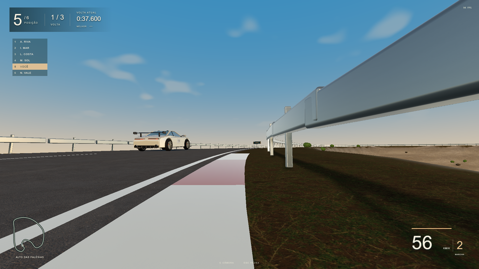

Arquivo: screenshots/s9-close-pista-97fps.png. Céu: 43.3%. Luminância média: 0.454; desvio: 0.222.

**Avaliação do veto visual (5.8):** Asfalto, zebra e guardrail estão visíveis após corrigir a câmera. A zebra e o metal têm aparência excessivamente uniforme no close; os mapas existentes não resolvem esse limite visual.

- Sem referência designada. O close permite ver o agregado do asfalto em 2048 px e as marcas pintadas seguindo a geometria da curva.
- O guardrail tem postes e perfil com espessura; as juntas entre segmentos ainda são mais repetitivas e regulares que numa estrada real.
- As zebras são faixas texturizadas rasas; não possuem todas as irregularidades, trincas e sujeira acumulada de uma superfície escaneada.

### S5 — vila-rua

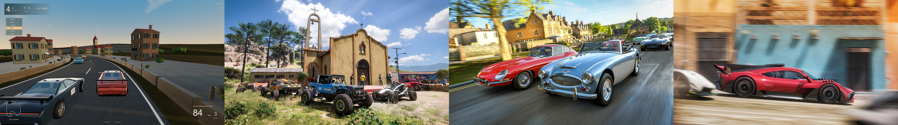

Arquivo: screenshots/s5-vila-rua-91fps.png. Céu: 33.2%. Luminância média: 0.373; desvio: 0.222.

**Avaliação do veto visual (5.8):** Abaixo do alvo: os intervalos entre edifícios e as grandes áreas pavimentadas parecem vazios. As fachadas têm volume, mas sua organização se repete.

- A igreja aparece ao fundo e as casas têm janelas recuadas, persianas, beirais e chaminés; a igreja é geometricamente mais simples que o marco da referência 05.
- As seis fachadas variam cor, altura, sacada e toldo, mas repetem a distribuição de janelas e ficam mais espaçadas que a rua da referência 06.
- O pavimento lateral e os muros seguem a rua; faltam desgaste localizado, placas comerciais e pequenos objetos nas fachadas com a riqueza da referência 07.

### S10 — baixa-vila

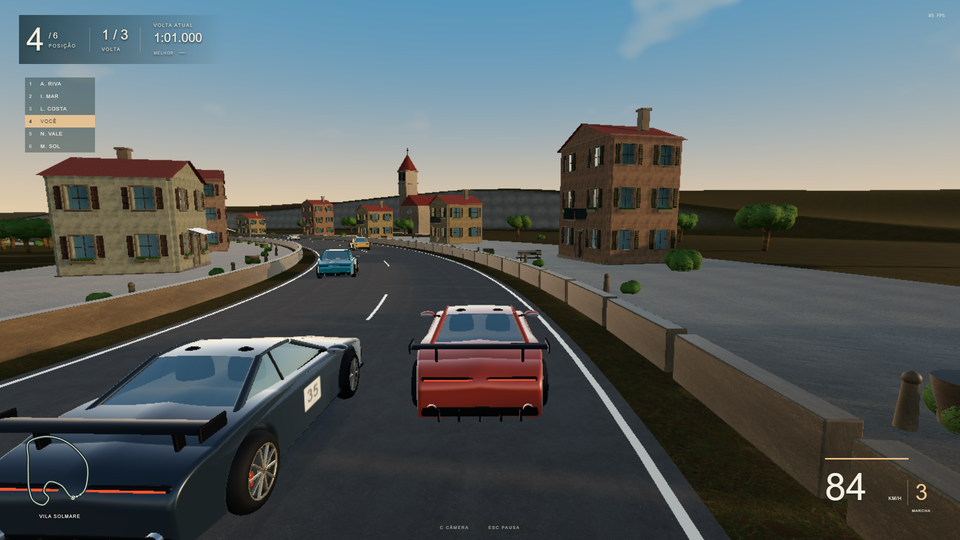

Arquivo: screenshots/s10-baixa-vila-87fps.png. Céu: 33.2%. Luminância média: 0.372; desvio: 0.220.

**Avaliação do veto visual (5.8):** Mantém os problemas visuais de S5: espaços vazios e repetição arquitetônica. As formas continuam modeladas no preset Baixa.

- Sem referência designada; comparação com S5. O preset Baixa mantém os mesmos edifícios, carros e mapas PBR.
- A resolução interna menor suaviza detalhes de janelas, pneus e pintura; diagonais finas têm menos definição.
- As sombras têm menor resolução, a vegetação distante desaparece antes e o bloom/desfoque ficam desativados.

### S11 — escala

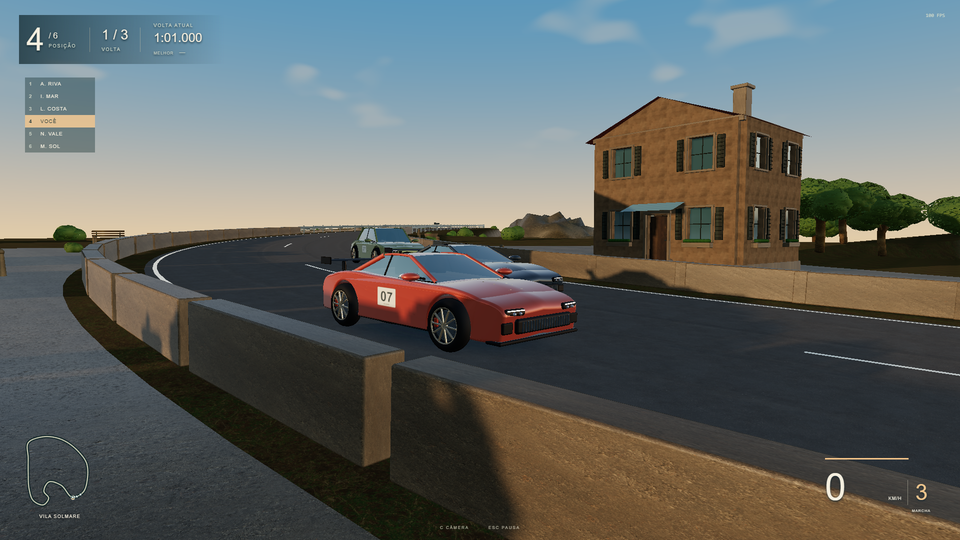

Arquivo: screenshots/s11-escala-100fps.png. Céu: 36.6%. Luminância média: 0.391; desvio: 0.218.

**Avaliação do veto visual (5.8):** Carro e casa têm apoio aparente no solo; a porta permite comparar escala. O muro encobre parte da fachada e as áreas laterais continuam pouco detalhadas.

- Sem referência designada. O carro parado e a casa aparecem no mesmo sistema métrico; a porta foi modelada com 2,10 m de altura e o carro tem cerca de 1,3 m.
- Persianas, molduras e toldo têm volume, mas o muro lateral encobre parte da região inferior da fachada.
- A fundação acompanha o solo, embora a transição entre a base da casa e o pavimento ainda seja mais uniforme e limpa que uma construção real.

### S6 — bosque-luz

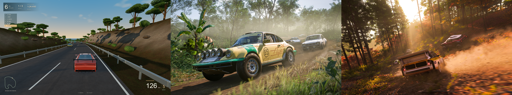

Arquivo: screenshots/s6-bosque-luz-100fps.png. Céu: 25.9%. Luminância média: 0.312; desvio: 0.207.

**Avaliação do veto visual (5.8):** Reprovado pela repetição das copas e pelo sub-bosque pouco preenchido. Céu e sombras são visíveis; a densidade numérica não corresponde à riqueza visual das referências.

- Pinheiros e oliveiras lançam sombras atravessando a pista; a copa é mais aberta e a densidade de folhas é menor que a da referência 08.
- O terreno tem solo texturizado, arbustos e rochas; o sub-bosque ainda é menos estratificado que a mistura de plantas altas e baixas da referência.
- O sol é rasante e quente, mas a cena não reproduz os feixes volumétricos e a poeira suspensa iluminada da referência 10.

### S7 — ponte-ou-tunel

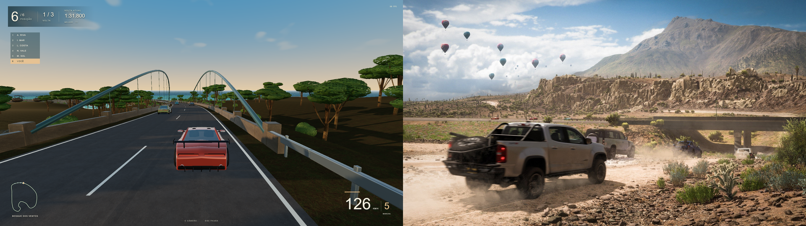

Arquivo: screenshots/s7-ponte-ou-tunel-97fps.png. Céu: 37.3%. Luminância média: 0.360; desvio: 0.241.

**Avaliação do veto visual (5.8):** A estrutura está conectada à estrada, sem penetração aparente na imagem. O entorno é esparso e as copas repetidas continuam abaixo do alvo visual.

- A ponte tem arcos metálicos, tirantes e parapeito de pedra ligados ao traçado; sua estrutura é diferente da ponte de concreto baixa da referência 14.
- A câmera mostra a travessia por cima do tabuleiro; a referência evidencia mais claramente os pilares e o vão visto lateralmente.
- O entorno tem árvores e litoral, mas não reproduz a variedade de rocha exposta, campos e relevo montanhoso ao fundo da referência.

## Limites da evidência

O teste automático audita geometria, mapas, contagens e regras; isso não equivale ao acabamento artístico das referências. O benchmark integral só deve ser considerado aprovado após a avaliação visual e a reprodução nos hardwares de referência. O áudio usa gravações CC0; os carros e o cenário são modelados proceduralmente pelo código original deste projeto.
