# REPORT — Costa Dourada (Racing-bench V3.4)

Generated by `npm run verify` on 2026-11-07 18:54:19 UTC (total 11.4 min; includes partial re-runs of: shots | shots). Numbers below were measured by that run; the prose comes from `scripts/verify/notes.json`.

## Failures and shortfalls declared up front

- Spec 5.6 — ambient occlusion in the junctions (wall/road, wall/house, car/ground) is NOT implemented: there is no SSAO and no baked AO; only the texture AO channel and the projected contact shadow under each car. Visible in S5/S9/S11.
- Spec 5.6 — lens flare is NOT implemented; the sun is a clamped HDRI disc plus bloom, so the sun disc is not crisply visible in S1 (the sun-facing shots burn out in the glare). S4 and S8 were framed with the sun outside the picture: that is a composition choice, not a fix.
- Spec 5.1 — the two cars are continuous curved procedural bodies (> 15 k triangles, 10–11 materials) but their design is stylised and far from the commercial references: bulbous nose, no mirrors/handles/vents/wing struts, tyres without sidewall detail.
- Spec 4 (Z4) — 'Bosque' is a pine-and-olive slope with a bridge, not a dense forest; S6 does not read as woodland the way refs 08/10 do.
- Spec 4 (Z1) — rocks standing in the water are few and small in frame (S3): 4 boulder variants with an animated white-water ring each; the beach has no dune vegetation tufts or puddles in that view.
- Spec 5.6 — motion blur is a speed-driven radial blur (car and HUD excluded), much weaker than refs 01/06/13; there is no depth of field.
- Spec 13.3 — the Low preset was not run on an integrated GPU; only this desktop was measured.

## Environment

- GPU: ANGLE (NVIDIA, NVIDIA GeForce RTX 3070 Ti (0x00002482) Direct3D11 vs_5_0 ps_5_0, D3D11) (Google Inc. (NVIDIA)) · CPU: AMD Ryzen 7 5700G with Radeon Graphics (16 threads) · RAM 31.9 GB · OS: Windows_NT 10.0.26300 x64
- Browser: chrome 150.0.7871.127 — Mozilla/5.0 (Windows NT 10.0; Win64; x64) AppleWebKit/537.36 (KHTML, like Gecko) HeadlessChrome/150.0.0.0 Safari/537.36
- Screenshots and performance at 1920×1080, device pixel ratio 1; Node v24.14.1

## 13.1 Automated tests

### Test 1 — journey: menu → car → 3 laps vs 5 AIs → results → race again

Result: PASS · log: `logs/journey-3laps.log`

| check | result | evidence |
| --- | --- | --- |
| menu-shown-with-live-background | PASS | `"demo race with 6 cars behind the menu"` |
| car-selected | PASS | `{"name":"Veloce GT"}` |
| grid-presentation-lists-6-cars | PASS | `6` |
| countdown-3-2-1-go | PASS | `["3","2","1","VAI!"]` |
| race-with-5-ai | PASS | `{"state":"racing","n":6,"ai":5}` |
| keyboard-input-moves-the-car | PASS | `73.36` |
| reached-results-screen | PASS | `332.86` |
| results-table-6-rows | PASS | `6` |
| player-completed-all-laps | PASS | `{"laps":3,"lapTimes":[117.58,103.74,103.06]}` |
| others-without-finish-show-approximate-time | PASS | `["05:27.250","≈ 05:35.429","≈ 05:36.579","≈ 05:40.322","≈ 05:46.239","≈ 05:47.445"]` |
| no-car-under-terrain | PASS | `0` |
| no-collider-crossing | PASS | `{"crossings":0,"maxPenetrationM":0.042}` |
| no-car-fell-out-of-world | PASS | `0` |
| camera-never-inside-geometry | PASS | `{"frames":4040,"violations":0,"minClearanceM":1.52}` |
| ai-never-stuck-or-off-road-over-5s | PASS | `{"aiStuckEvents":0,"longestStuckOrOffSeconds":0}` |
| at-least-one-overtake-between-ais | PASS | `8` |
| race-again-starts-clean | PASS | `{"t":0,"laps":[0,0,0,0,0,0],"n":6,"state":"grid"}` |
| second-race-runs | PASS | `{"t":15.07,"positions":[4,2,1,3,5,6]}` |
| no-console-errors | PASS | `[]` |

Results table shown to the player:

| # | driver | car | time | best lap |
| --- | --- | --- | --- | --- |
| 1 | Você | Veloce GT | 05:27.250 | 01:43.058 |
| 2 | Rafael Duarte | Veloce GT | ≈ 05:35.429 | 01:51.325 |
| 3 | Inês Barros | Pulse RS | ≈ 05:36.579 | 01:52.367 |
| 4 | Luca Marchetti | Veloce GT | ≈ 05:40.322 | 01:53.725 |
| 5 | Théo Lambert | Veloce GT | ≈ 05:46.239 | 01:56.500 |
| 6 | Maya Costa | Pulse RS | ≈ 05:47.445 | 01:55.142 |

Race integrity counters: `{"underTerrain":0,"aiStuck":0,"overtakesAI":8,"maxVoices":0,"wallHits":0,"colliderCross":0,"maxWallPen":0.04228485666267545,"maxAirborne":0,"fellOut":0}`; camera: `{"frames":4040,"violations":0,"minClear":1.52}`; resets per car: `[0,0,0,0,0,0]`

### Test 2 — same journey with 6 laps (Pulse RS)

Result: PASS · log: `logs/journey-6laps.log`

| check | result | evidence |
| --- | --- | --- |
| menu-shown-with-live-background | PASS | `"demo race with 6 cars behind the menu"` |
| car-selected | PASS | `{"name":"Pulse RS"}` |
| grid-presentation-lists-6-cars | PASS | `6` |
| countdown-3-2-1-go | PASS | `["3","2","1","VAI!"]` |
| race-with-5-ai | PASS | `{"state":"racing","n":6,"ai":5}` |
| keyboard-input-moves-the-car | PASS | `90.36` |
| reached-results-screen | PASS | `636.15` |
| results-table-6-rows | PASS | `6` |
| player-completed-all-laps | PASS | `{"laps":6,"lapTimes":[108.82,103.47,103.47,103.47,103.41,103.42]}` |
| others-without-finish-show-approximate-time | PASS | `["10:28.533","≈ 11:13.278","≈ 11:18.738","≈ 11:19.206","≈ 11:30.445","≈ 11:30.597"]` |
| no-car-under-terrain | PASS | `0` |
| no-collider-crossing | PASS | `{"crossings":0,"maxPenetrationM":0.06}` |
| no-car-fell-out-of-world | PASS | `0` |
| camera-never-inside-geometry | PASS | `{"frames":7084,"violations":0,"minClearanceM":1.55}` |
| ai-never-stuck-or-off-road-over-5s | PASS | `{"aiStuckEvents":0,"longestStuckOrOffSeconds":1.85}` |
| at-least-one-overtake-between-ais | PASS | `11` |
| race-again-starts-clean | PASS | `{"t":0,"laps":[0,0,0,0,0,0],"n":6,"state":"grid"}` |
| second-race-runs | PASS | `{"t":15.1,"positions":[3,2,1,5,4,6]}` |
| no-console-errors | PASS | `[]` |

Results table shown to the player:

| # | driver | car | time | best lap |
| --- | --- | --- | --- | --- |
| 1 | Você | Pulse RS | 10:28.533 | 01:43.408 |
| 2 | Inês Barros | Pulse RS | ≈ 11:13.278 | 01:52.133 |
| 3 | Rafael Duarte | Veloce GT | ≈ 11:18.738 | 01:51.100 |
| 4 | Luca Marchetti | Veloce GT | ≈ 11:19.206 | 01:53.500 |
| 5 | Théo Lambert | Veloce GT | ≈ 11:30.445 | 01:56.500 |
| 6 | Maya Costa | Pulse RS | ≈ 11:30.597 | 01:55.150 |

Race integrity counters: `{"underTerrain":0,"aiStuck":0,"overtakesAI":11,"maxVoices":0,"wallHits":0,"colliderCross":0,"maxWallPen":0.05974651631695771,"maxAirborne":0,"fellOut":0}`; camera: `{"frames":7084,"violations":0,"minClear":1.55}`; resets per car: `[0,0,0,0,0,0]`

### Test 3 — pause/resume, restart in the middle, back to menu, heap after 3 restarts

Result: PASS · log: `logs/pause-restart.log`

| check | result | evidence |
| --- | --- | --- |
| pause-freezes-the-race | PASS | `{"t1":2.52,"t2":2.52}` |
| pause-muffles-audio | PASS | `{"shown":true,"paused":true,"gain":0.1599999964237213,"lp":420}` |
| resume-continues | PASS | `{"before":2.52,"after":4.02}` |
| restart-1-clean-state | PASS | `{"t":0}` |
| restart-2-clean-state | PASS | `{"t":0}` |
| restart-3-clean-state | PASS | `{"t":0}` |
| heap-stable-after-3-restarts | PASS | `{"baselineMB":682.1,"afterMB":[660.5,679.7,662.2]}` |
| gpu-objects-stable-after-3-restarts | PASS | `{"base":{"calls":1328,"tris":6439401,"geometries":573,"textures":63,"programs":73},"after":{"calls":1371,"tris":6447837,"geometries":574,"textures":63,"programs":73}}` |
| audio-sources-and-voices-return-to-initial-value | PASS | `{"base":{"liveSources":58,"voices":18,"shots":6,"raceVoices":6,"aiVoices":5,"ctx":"running","stats":{"voices":18,"aiVoices":5,"maxVoices":25,"maxAiVoices":5,"peak":0.5248` |
| back-to-menu-without-old-race | PASS | `{"race":false,"demo":true,"hud":false,"audio":{"liveSources":60,"voices":24,"shots":14,"raceVoices":6,"aiVoices":5,"ctx":"running","stats":{"voices":24,"aiVoices":5,"maxV` |
| menu-audio-voices-sane | PASS | `{"liveSources":60,"voices":24,"shots":14,"raceVoices":6,"aiVoices":5,"ctx":"running","stats":{"voices":24,"aiVoices":5,"maxVoices":37,"maxAiVoices":5,"peak":0.55530518293` |
| no-console-errors | PASS | `[]` |

### Test 4 — anti-cut

Result: PASS · log: `logs/anticut.log`

| check | result | evidence |
| --- | --- | --- |
| crossing-the-line-without-checkpoints-gives-no-lap | PASS | `{"laps":0,"events":[{"t":8.966666666666798,"car":0,"type":"line-no-lap","cp":1}],"cpNext":1}` |
| shortcut-jump-is-not-credited | PASS | `{"before":256,"after":257,"lost":true}` |
| legitimate-lap-counts | PASS | `{"laps":1,"times":[116.69166666670833]}` |

### Test 5 — AI

Evaluated inside tests 1 and 2 (checks `ai-never-stuck-or-off-road-over-5s` and `at-least-one-overtake-between-ais`).

### Test 6 — integrity

validateWorld(): PASS · stats `{"maxBankDeg":5.47,"maxGradePct":9.86,"minRadiusM":30.9,"lengthM":3047.5,"worstTerrainAboveRoad":-0.0372,"worstEdgeGap":0.0688,"objects":4033,"exclusionViolations":0,"floatBury":0,"houseOverlaps":0,"checkpoints":12}`; in-race invariants are the checks `no-car-under-terrain`, `no-collider-crossing`, `no-car-fell-out-of-world` and `camera-never-inside-geometry` of tests 1 and 2.

### Test 7 — image sanity (S1–S9)

Limits: sky ≥ 10 % (in-game sky mask), luminance mean 0.25–0.75, std ≥ 0.12, no colour (5 bits/channel) above 30 % of the frame. Raw values: `image-metrics.json`.

| shot | sky % | lum mean | lum std | max colour share | result |
| --- | --- | --- | --- | --- | --- |
| s1 | 23.4 | 0.5374 | 0.2113 | 2.0% | PASS |
| s2 | 29.1 | 0.4585 | 0.1391 | 4.2% | PASS |
| s3 | 48.6 | 0.5259 | 0.1335 | 2.3% | PASS |
| s4 | 30.9 | 0.4995 | 0.1766 | 1.2% | PASS |
| s5 | 40.2 | 0.4787 | 0.1588 | 3.0% | PASS |
| s6 | 27.9 | 0.4479 | 0.1602 | 1.5% | PASS |
| s7 | 35.3 | 0.429 | 0.1227 | 2.5% | PASS |
| s8 | 30.1 | 0.4827 | 0.1628 | 1.6% | PASS |
| s9 | 40.7 | 0.4547 | 0.141 | 2.5% | PASS |

### Test 8 — scene audit (read from the live scene graph; full data in `scene-stats.json`)

- Cars at LOD0: Veloce GT: 84016 triangles, 11 distinct materials · Pulse RS: 81224 triangles, 10 distinct materials → PASS
- Box detector (≤ 12 triangles or BoxGeometry, > 1 m, within 50 m of the road): 0 found among 936 near meshes → PASS
- Flat-colour detector (visible near-road material with neither albedo nor normal map; glass/emissive/water excepted): 0 found → PASS
- Houses: 97 placed, 80 within 30 m of the road in the village (≥ 25), 8 variants (≥ 5); vegetation species 5 (pine, olive, palm, grass, shrub); props per 100 m: min 16, mean 34.9 (≥ 12), 20 prop kinds → PASS
- Textures: arrays 9×1024², 2×2048², 17×1024²; asphalt 2048² → PASS
- Player engine built from AudioBuffers: yes (7 looped recordings, v8 timbre; no oscillator in the engine path) → PASS

### Test 9 — camera sweep every 25 m

122 positions captured in `sweep/` (+ `sweep-sheet.png`); 122 pass the Test-7 limits, 0 fail.

## 13.2 Audio

Recording: `audio-volta.wav` (138.8 s, 48000 Hz stereo, taken after the master limiter) and `volta.webm` (139 s, video/webm;codecs=vp9,opus, canvas + HUD + the same master audio). One full real-time lap with the 5 AIs (player on the test autopilot plus two scripted manoeuvres that provoke a skid and a wall contact).

- **Master peak: -5.25 dBFS** (limit −1.0), measured on the written WAV; the in-engine meter reads -5.25 dBFS. Limiter: worklet-lookahead.
- **Maximum simultaneous voices: 27** audible voices in total (engines, tyre/wind/contact layers, ambience, one-shots), of which at most **5 AI engine voices** (limit 5).
- Instants (mm:ss from the start of the recording): gear shifts 53 (first: 00:08.4, 00:08.7, 00:08.9, 00:09.1, 00:09.6, 00:09.8, 00:11.9, 00:13.4); skid 00:10.5, 00:12.2, 00:24.1, 00:27.8, 00:48.1, 00:49.9, 00:59.8, 01:07.2; collision 00:09.9, 00:25.3, 00:27.0, 00:45.2, 00:48.6, 00:48.9, 00:51.0, 01:01.4; guard-rail scrape 00:25.3, 00:27.0, 00:48.6, 00:51.0, 01:01.4; bridge bridge-enter@01:54.6, bridge-exit@01:57.7 (this circuit has a bridge, not a tunnel: it changes the rolling sound and opens the reverb send); AI passing 00:01.4 player-overtakes, 00:01.5 player-overtakes, 00:02.7 player-overtakes, 00:02.7 player-overtakes, 00:02.7 player-overtakes, 00:09.4 ai-overtakes, 00:10.1 ai-overtakes, 00:24.6 player-overtakes, 00:25.6 player-overtakes, 00:51.3 player-overtakes.
- After 3 restarts the live audio sources and race voices return to the initial value: test 3, check `audio-sources-and-voices-return-to-initial-value`.

| check | result | evidence |
| --- | --- | --- |
| full-lap-completed-in-real-time | PASS | `{"state":"finished","s":1.1361614588998987,"laps":1,"t":130.70000000004546,"kmh":122.61479298327616,"fin":true}` |
| master-peak-at-or-below-minus-1-dbfs | PASS | `{"peakLinear":0.546173095703125,"peakDbfs":-5.25,"seconds":138.8}` |
| events-logged-shift-skid-impact-bridge | PASS | `{"shifts":53,"skids":8,"impacts":8,"bridge":2,"aiPass":10}` |
| max-ai-voices-at-most-5 | PASS | `{"maxAiVoices":5,"maxVoicesTotal":27}` |
| player-engine-uses-audio-buffers | PASS | `{"kind":"v8","bufferSources":7,"buffersBound":7,"bands":[{"f0":52.91,"file":"assets/audio/engine/v8-053-181460.wav"},{"f0":69.33,"file":"assets/audio/engine/v8-069-181460` |
| video-recorded-with-audio-track | PASS | `{"bytes":32502216,"mime":"video/webm;codecs=vp9,opus","frames":3536,"seconds":139}` |
| no-console-errors | PASS | `[]` |

## 13.3 Performance (Z3 village, 5 AIs in view, 15 s measured, 1920×1080)

| preset | avg FPS | 1 % low FPS | median frame ms | p99 ms | draw calls | triangles | load (s) |
| --- | --- | --- | --- | --- | --- | --- | --- |
| Alta | 122.8 | 83.1 | 8.08 | 11.1 | 1269 | 4.43 M | 12.9 |
| Baixa | 174.3 | 125.8 | 5.66 | 7.44 | 816 | 3.19 M | 11.4 |

Hardware: ANGLE (NVIDIA, NVIDIA GeForce RTX 3070 Ti (0x00002482) Direct3D11 vs_5_0 ps_5_0, D3D11); AMD Ryzen 7 5700G with Radeon Graphics; chrome 150.0.7871.127; 1920×1080, DPR 1. The Low preset renders at 0.75× resolution without MSAA/AO/motion blur, with 2 shadow cascades at 1024 px. It was **not** run on an integrated GPU, so the "≥ 60 FPS on a recent iGPU" target is unverified.

## 13.4 Screenshots (real race, High, 1920×1080, HUD and AIs present except S2/S11/S12)

### S1 — Reta da orla em velocidade, sol à frente

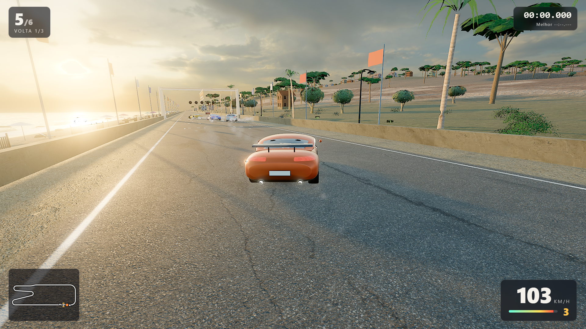

- File: `s1-reta-orla.png` (also `s1-reta-orla-fps100.png`) · FPS at capture: **100** · quality: high · compared with ref 01, 02: `compare/s1.png`, `compare/s1-ref02.png`
- Metrics: sky 23.4% · luminance mean 0.5374, std 0.2113 · most common colour 2.0%

**Concrete differences against the reference:**

1. Ref 01 streaks the road and the roadside with strong anamorphic motion blur and a dusty bloom that lifts the shadows; ours is almost sharp at 103 km/h (only a faint radial blur at the frame edges, with the car and HUD masked), so the speed feeling is much weaker.
2. Ref 01 silhouettes tall dark palms against a blown-out sunset with warm rim light; ours has small, front-lit mid-green palms and umbrella pines, and the sun is only a bright patch behind the start gantry (no visible disc, no god-rays).
3. Ref 01's hero car has reflective paint, decals, a big wing and detailed tail lamps; ours is a rounded orange GT seen from behind with a plain paint, a small wing and no decals, mirrors or exhaust detail.
4. Ref 01/02 have dense dust, scrub and pebbles beside the road; the right side of ours is a smooth dune slope with sparse grass tufts and a stone wall, and the left shows only a sliver of sea.

**Self-assessment against the visual veto (5.8):** No car under the ground or floating; the road is textured (cracks, rubber line, worn edge) not a flat grey band; sea and sky are present (sky 23 %); shadows of poles and walls are clearly visible; no solid-colour area; no pop-in seen; the sun-side of the frame (top-left) is burnt out by glare and the sun disc itself is not visible; the dune slope on the right is the emptiest stretch ('trecho vazio' is borderline) and the palms/pines repeat a few variants.

**Below target:** speed feeling (blur), sun disc and rays, roadside density, car detail.

### S2 — Carro no grid, 3/4 frontal baixa (sem HUD)

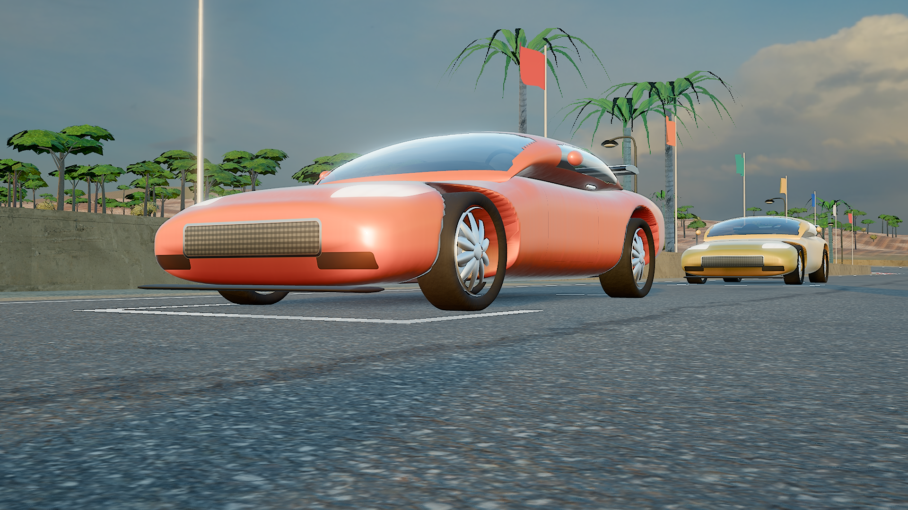

- File: `s2-grid-3-4.png` (also `s2-grid-3-4-fps100.png`) · FPS at capture: **100** · quality: high · compared with ref 11: `compare/s2.png`
- Metrics: sky 29.1% · luminance mean 0.4585, std 0.1391 · most common colour 4.2%

**Concrete differences against the reference:**

1. Ref 11 is a wide-body Supra with a carbon wing on struts, side vents, LED tail lamps and a plate; ours is a smooth bubble GT: no wing struts, vents or mirrors in view, one continuous orange paint with a mesh grille and a chrome frame as the only front detail.
2. Ref 11 sits in a ruined hangar with volumetric rays, dust and hard sun/shadow contrast; ours stands on an open street with soft sunset light, no volumetrics and a plain grid-box marking.
3. Ref 11's wheels are deep-dish with big calipers and low-profile tyres with sidewall branding; ours has 10-spoke rims, discs and calipers but round, thick tyres with no sidewall text.
4. Ref 11's surroundings are rich (tyre stack, vines, rust, a second car in shadow); ours has a repeated line of palms/pines and a second car of the same design in the background.

**Self-assessment against the visual veto (5.8):** Not a car of boxes (curved body, rounded arches), glass is tinted with sky reflection and an interior (not flat black), the contact shadow is present, no floating/sunken wheels, shadows are visible; the weakness is the stylised proportions, not a veto item.

**Below target:** car design, reflections resolution, background richness; no HUD by design.

### S3 — Câmera baixa: areia molhada, espuma, rochas

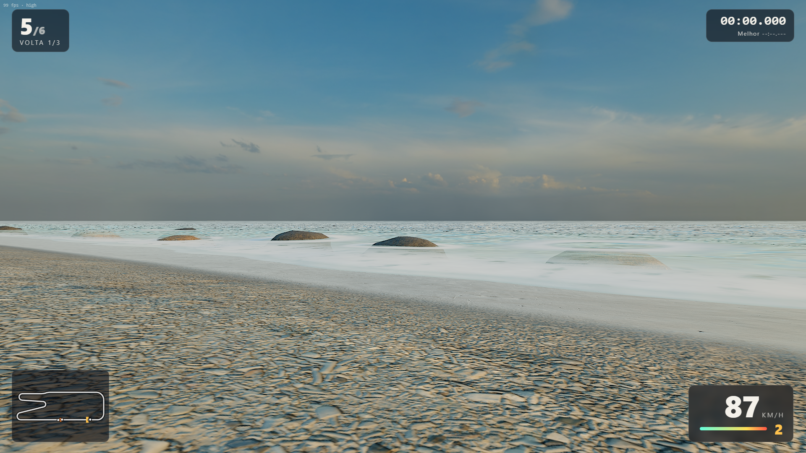

- File: `s3-praia-espuma.png` (also `s3-praia-espuma-fps99.png`) · FPS at capture: **99** · quality: high · compared with ref 02, 04: `compare/s3.png`, `compare/s3-ref04.png`
- Metrics: sky 48.6% · luminance mean 0.5259, std 0.1335 · most common colour 2.3%

**Concrete differences against the reference:**

1. Ref 04 has dune fences, rippled sand, wet reflective patches and tufts of dune grass; ours is a pebbly wet-sand texture with a smooth foam band and no vegetation, puddles or fence in this frame (the 98 sand-fence pieces are elsewhere on the beach).
2. Ref 02 has big detailed rock faces and pebbles; ours has only four small boulders standing 15–25 m out in the surf, each with a faint white ring, so the 'rochas com espuma' read weakly.
3. Ref 02's sea is turquoise in the shallows with a bay and mountains; ours is pale foam into flat blue with little depth colour change in view and only a haze-grey hill on the horizon.
4. Ref 02/04 contain cars and dust; the AIs and the player are off-frame in ours (placed behind the camera line), so no cars are visible here.

**Self-assessment against the visual veto (5.8):** Sea is not flat or foam-less (animated shore foam and rings around rocks), wet sand is darker, the sky is large (48 %), shadows are minimal because the frame is mostly sand/sea; no solid-colour area but the sand texture repeats across the lower half of the frame (texture repetition borderline).

**Below target:** rock size/number in frame, beach life (fences, tufts), no cars in the frame, sea colour depth.

### S4 — Serpentina com o mar abaixo (do mirante)

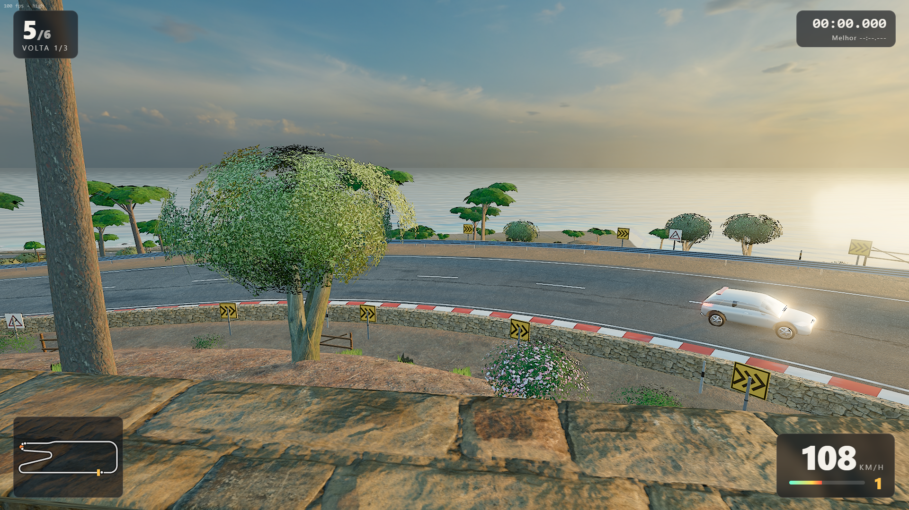

- File: `s4-falesia-mirante.png` (also `s4-falesia-mirante-fps100.png`) · FPS at capture: **100** · quality: high · compared with ref 02: `compare/s4.png`
- Metrics: sky 30.9% · luminance mean 0.4995, std 0.1766 · most common colour 1.2%

**Concrete differences against the reference:**

1. Ref 02 shows a tall stratified rock face on the left and a sweeping beach below; ours looks down from a stone terrace onto a smooth orange-beige slope: the cliff has no rock strata, only terrain texture.
2. Ref 02 scatters cacti, shrubs and boulders; ours is dominated by one large olive tree in the left third of the frame, with a few shrubs, chevron signs and a wooden fence.
3. Ref 02's sea is a curved bay with surf and mountains; ours is a straight, calm horizon under a warm haze with no coastline shape and no surf visible from this height.
4. The ref's hero truck fills the frame and throws dust; our cars are small on the serpentine below (kerb, chevrons and guard-rail are readable, the white hatch is the only car in frame and raises no dust).

**Self-assessment against the visual veto (5.8):** Road has kerb stripes, chevrons and a guard-rail (not a grey band); the sea and a large sky (31 %) are visible; nothing floats; the sun was deliberately kept out of the frame so there is no burnt-out area; the stone terrace in the foreground repeats one tile.

**Below target:** cliff geometry, vegetation variety, coastline shape, car scale/dust.

### S5 — Rua da vila com o marco visível

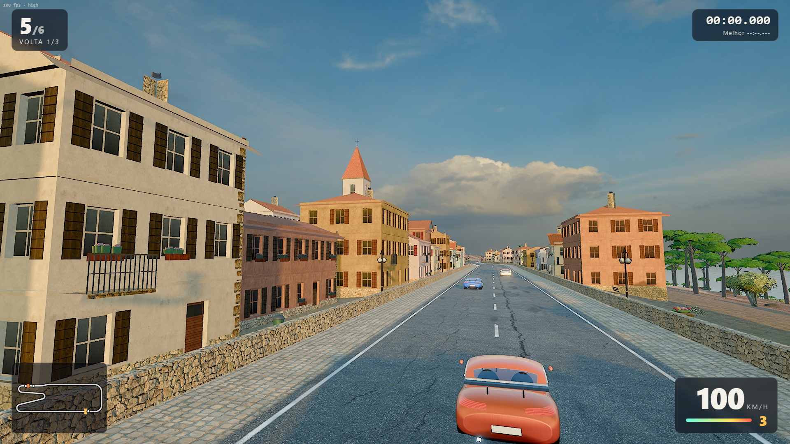

- File: `s5-vila-rua.png` (also `s5-vila-rua-fps100.png`) · FPS at capture: **100** · quality: high · compared with ref 05, 06, 07: `compare/s5.png`, `compare/s5-ref06.png`, `compare/s5-ref07.png`
- Metrics: sky 40.2% · luminance mean 0.4787, std 0.1588 · most common colour 3.0%

**Concrete differences against the reference:**

1. Ref 05 puts a large adobe church with a bell gable, people and vehicles on a plaza; ours shows the church only as a small red-roofed spire between the houses ahead, with no plaza activity or people.
2. Ref 06 has stone cottages with chimneys, climbing plants and overhanging trees under strong motion blur; ours has plaster houses with shutters, balconies and flower boxes but clean facades, no climbing plants and few street trees.
3. Ref 07 shows grimy plaster up close; ours uses 1k plaster tiles that look clean in the shade and have no ambient occlusion where wall meets pavement.
4. The player's car sits small at the bottom of the frame and the asphalt takes about a third of the image (cracks vary it, but it is a large repeated surface).

**Self-assessment against the visual veto (5.8):** Houses have roofs with eaves, windows with recess and shutters, doors and balconies (not cubes); the street is open sky (sky 39 %); no objects through the road; texture repetition on the asphalt is acceptable but visible; no pop-in seen.

**Below target:** landmark prominence, facade grime/vegetation, AO, people/activity.

### S6 — Bosque com sol rasante

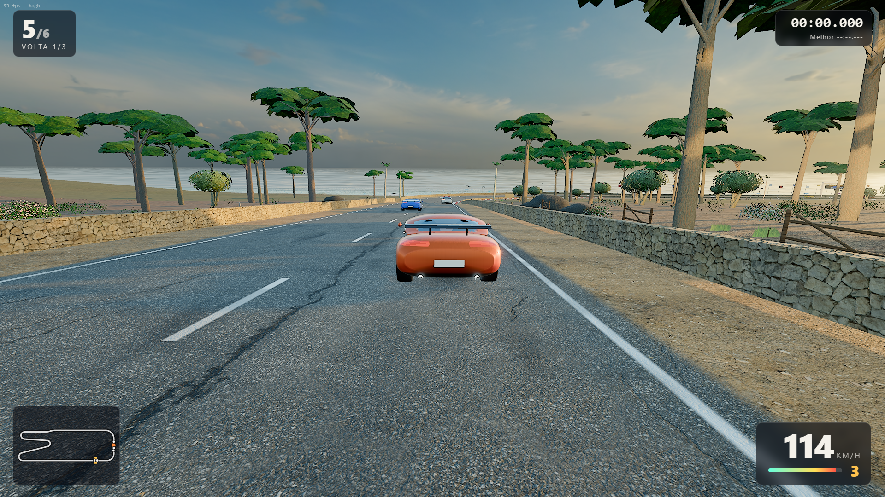

- File: `s6-bosque-luz.png` (also `s6-bosque-luz-fps93.png`) · FPS at capture: **93** · quality: high · compared with ref 08, 10: `compare/s6.png`, `compare/s6-ref10.png`
- Metrics: sky 27.9% · luminance mean 0.4479, std 0.1602 · most common colour 1.5%

**Concrete differences against the reference:**

1. Ref 10 has dense tall pines with volumetric rays, dust and orange leaf litter; ours is a wide-spaced line of umbrella pines on a dune slope under a bright sky, with no rays or dust, so it does not read as a forest.
2. Ref 08 has lush undergrowth (ferns, broad leaves) and haze depth; ours has sparse grass tufts and shrubs on dry orange-brown ground.
3. Ref 08's road is a dusty dirt track with tyre marks and dust clouds behind the cars; ours is clean asphalt with no dust from the cars.
4. Ref 10's low sun comes through the trunks and rim-lights the leaves; ours has side light and long shadows on the road but the canopy is not translucent.

**Self-assessment against the visual veto (5.8):** Not an enclosed corridor (sky 28 %), tree variants are visible but not identical in line, shadows are visible; the density of trees is the weakness.

**Below target:** forest density, undergrowth, dust, translucent foliage.

### S7 — Entrada da ponte ligada ao terreno

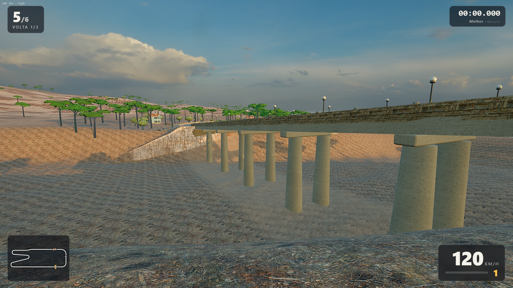

- File: `s7-ponte-ou-tunel.png` (also `s7-ponte-ou-tunel-fps100.png`) · FPS at capture: **100** · quality: high · compared with ref 14: `compare/s7.png`
- Metrics: sky 35.3% · luminance mean 0.429, std 0.1227 · most common colour 2.5%

**Concrete differences against the reference:**

1. Ref 14 is a large concrete overpass over a rocky desert valley with cliff outcrops; ours is a five-pier deck viaduct over a bare, smoothly eroded ravine with no rock outcrops.
2. The deck-to-terrain joint in ours is a stone abutment wall at the left plus the slope; the terrain texture repeats a dotted orange pattern on the ravine floor, unlike the varied rock and gravel of the ref.
3. Ref 14 shows vehicles on the structure and on the road below; ours has the cars before the entrance (off-frame) and no traffic under the bridge.
4. Ref 14 has railings, joints and cable/lamp details on the deck; ours has a plain parapet with lamp posts and a flat concrete underside.

**Self-assessment against the visual veto (5.8):** The bridge is anchored to the terrain (abutments and piers go below ground), nothing floats, sky is large (35 %); the ravine floor is a plain slope and the only repeated pattern is the ground texture.

**Below target:** structure detail (no arches), terrain richness, traffic.

### S8 — Jogador lado a lado com 2+ IAs

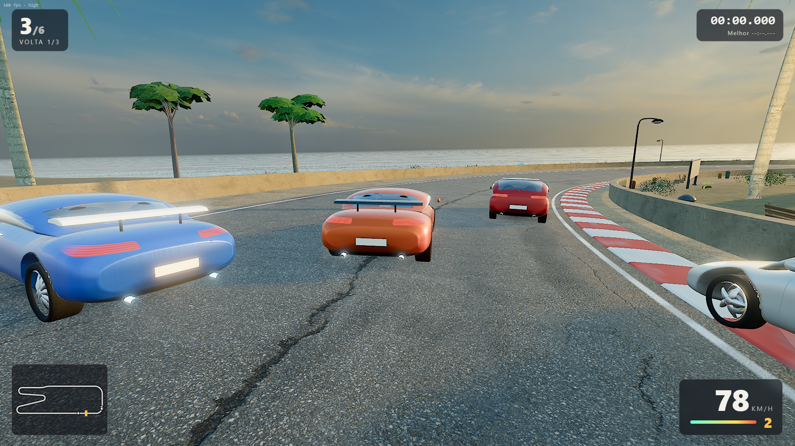

- File: `s8-disputa.png` (also `s8-disputa-fps100.png`) · FPS at capture: **100** · quality: high · compared with ref 09, 13: `compare/s8.png`, `compare/s8-ref13.png`
- Metrics: sky 30.1% · luminance mean 0.4827, std 0.1628 · most common colour 1.6%

**Concrete differences against the reference:**

1. Ref 13 shows three distinct cars at close three-quarter-front range under heavy motion blur; ours shows four sharp cars from behind on a bend, with only a faint blur at the frame edges, so only tail lamps and wings are visible.
2. Ref 09/13 cars are different makes with real grilles, lights, mirrors and decals; ours repeat the two procedural designs (blue GT, orange and red hatch/GT) with plain paint and no mirrors or decals.
3. Ref 09 sprays dust and leaves around the pack; ours has almost no particles in this frame (light tyre smoke only when sliding).
4. The ref's pack sits in rich surroundings (autumn trees, houses); ours shows the sea front with a wall, a lamp post and a few palms, and the asphalt fills the lower half of the frame.

**Self-assessment against the visual veto (5.8):** Cars are side by side on the road with contact shadows and visible side light; nothing floats or clips; the sky is open (31 %); no burnt-out area in this framing (the sun is outside the frame).

**Below target:** car variety and detail, motion blur, dust, background richness.

### S9 — Close de asfalto, zebra e guardrail

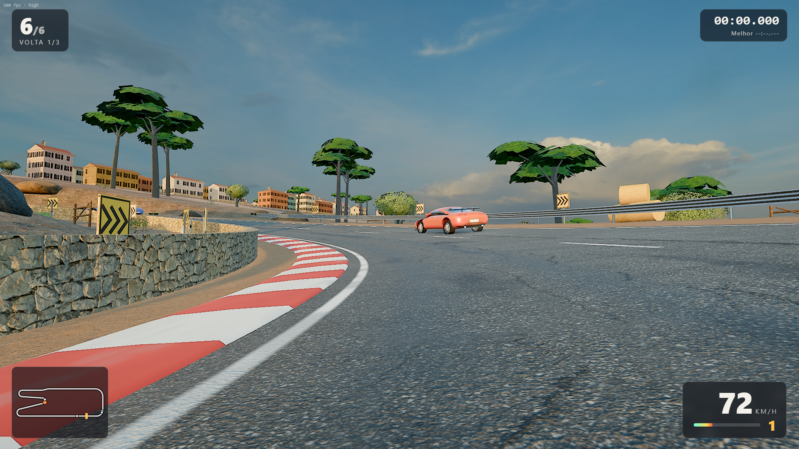

- File: `s9-close-pista.png` (also `s9-close-pista-fps100.png`) · FPS at capture: **100** · quality: high
- Metrics: sky 40.7% · luminance mean 0.4547, std 0.141 · most common colour 2.5%

**Concrete differences against the reference:**

1. Against a commercial close-up (e.g. refs 02/04 road edges) ours has a clean red/white kerb, a cracked asphalt tile and a guard-rail, but no tyre marks, debris, sand drift or gravel on the kerb.
2. The stone wall beside the kerb repeats the same 1k stone tile and has no moss, stains or AO at its base.
3. Guard-rail is a swept metal profile with posts and reflectors but no bolts, overlaps or dents.
4. The distant car is small and the foreground has no car, so there is no sense of speed.

**Self-assessment against the visual veto (5.8):** Asphalt is textured with paint lines and a worn edge (not a flat band); kerb and guard-rail are present; no solid-colour area.

**Below target:** surface wear details, AO, foreground subject.

### S10 — Posição de S5 em Baixa

- File: `s10-baixa-vila.png` (also `s10-baixa-vila-fps100.png`) · FPS at capture: **100** · quality: low
- Metrics: sky 40.2% · luminance mean 0.4765, std 0.1572 · most common colour 3.2%

**Concrete differences against the reference:**

1. Same camera and cars as S5 in the Low preset: internal resolution is 0.75×, so edges (power poles, balcony rails, roof tiles) are softer than in S5.
2. No MSAA in Low: roof edges and window frames show more stair-stepping than S5.
3. Shadows use 2 cascades at 1024 px, so shadow edges on the facades are blockier and the far shadows fade earlier; motion blur and AO are off (the latter is off in both).
4. Textures, house forms and road detail are unchanged — Low does not turn into flat blocks.

**Self-assessment against the visual veto (5.8):** Same assessment as S5: not blocks, open sky, textured surfaces.

**Below target:** not tested on an integrated GPU.

### S11 — Carro parado ao lado de uma casa com porta

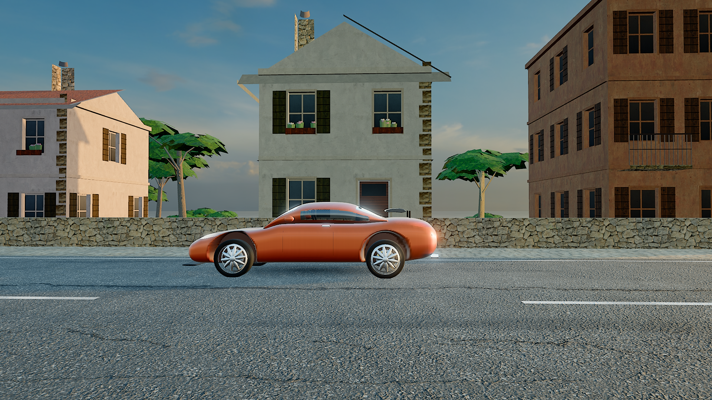

- File: `s11-escala.png` (also `s11-escala-fps100.png`) · FPS at capture: **100** · quality: high
- Metrics: sky 21.4% · luminance mean 0.4112, std 0.1613 · most common colour 2.8%

**Concrete differences against the reference:**

1. In a commercial scale shot the wall base would have AO, stains and plants; ours has clean plaster down to the pavement with no contact darkening.
2. The house door (2.1 m) and the three storeys (~3 m each) are readable against the 4.55 m car, but the car has no mirrors or door handles visible from the side, unlike the refs' cars.
3. The windows are recessed with shutters but have no curtains, glass reflection variety or interior.
4. The car's tyres are not squashed by load and the wheel arches are generous, so the car looks lighter than a real coupé next to a real wall.

**Self-assessment against the visual veto (5.8):** Car and house are plausible in scale, with shadows; the street wall behind the car is the same stone tile as elsewhere.

**Below target:** AO, wall grime, car side detail.

Scale: the car is 4.55 m long; the 3-storey house in frame has a 2.1 m door and ~3 m storeys (house variant 6, 6×5.6 m footprint, 7.2 m from the road edge).

### S12 — Vista de cima da volta inteira

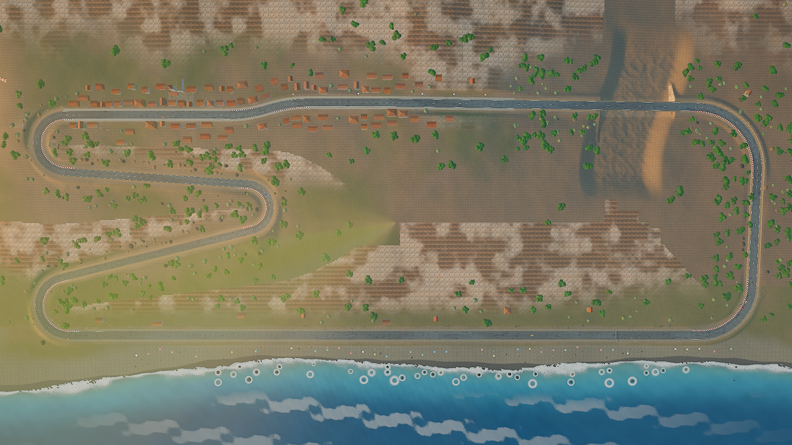

- File: `s12-mapa.png` (also `s12-mapa-fps99.png`) · FPS at capture: **99** · quality: high
- Metrics: sky 0% · luminance mean 0.4678, std 0.0852 · most common colour 2.6%

**Concrete differences against the reference:**

1. From above the terrain texture shows a dotted/tiled pattern and blotchy dirt patches that a commercial map would hide with macro variation.
2. The white rings around the sea rocks look like bubbles from this height.
3. The track is a thin ribbon without start-line, sector or zone markers; the HUD is hidden by design.
4. Houses are tiny red/white specks and the forest is scattered green dots; no landmarks are labelled.

**Self-assessment against the visual veto (5.8):** The whole lap is visible in one frame (Orla at the bottom, serpentine on the left, village top, bridge top right).

**Below target:** map readability and terrain macro variation.

## Honest assessment

- Single machine: every number in this report comes from one desktop (RTX 3070 Ti, Ryzen 7 5700G, headless Chrome). The ≥ 60 FPS target for an integrated GPU in the Low preset is unverified.
- The cars are procedural and stylised; they are not at the level of the commercial references (nose shape, arch edges, mirror/handle details, interior).
- No screen-space ambient occlusion, no lens flare; motion blur is a radial blur driven by speed with the player's car and the HUD excluded. Contact shadows under the cars are projected blobs.
- The circuit has a bridge, not a tunnel; the bridge changes the rolling sound and opens a reverb send.
- The AIs are slower than the test autopilot (Normal difficulty ≈ 113–117 s laps vs ≈ 103 s) and there is no rubber-banding; Hard uses the same limits as the autopilot.
- Music is two CC0 tracks (menu/garage/setup and results); nothing plays during the race. The engine loops come from two CC0 recordings, so the two timbres share raw material (pitched / filtered differently).
- Shadow shimmer, pop-in of vegetation LODs and the 'bloom estourado' veto are judged by eye on the screenshots and video; there is no automatic detector for them.
- The quality switch reloads the page (it re-creates the renderer, shadow maps and post chain), it does not hot-swap presets.
- Measured FPS depends on the machine: the verifier turns the browser frame-rate limiter off for the performance step, other steps run at the display cadence (≈ 100 Hz here), so the FPS in screenshot file names is capped by it.
